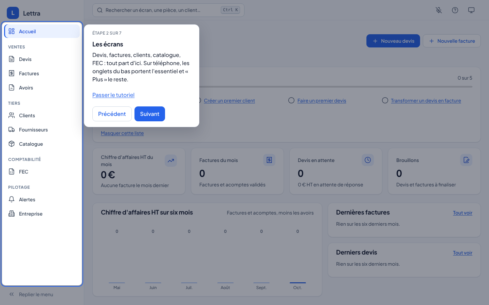
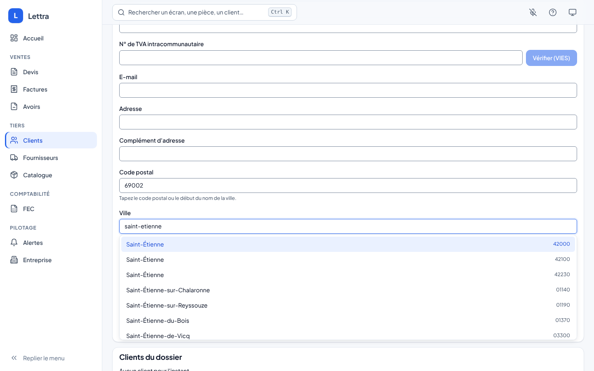
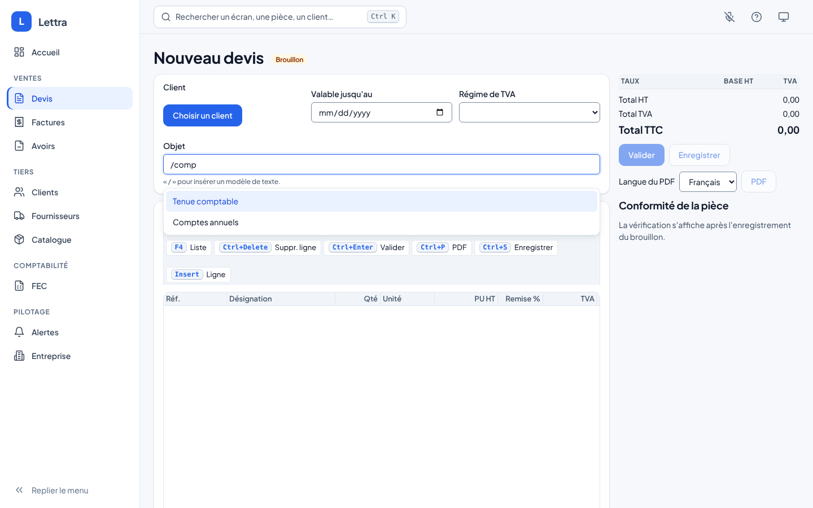
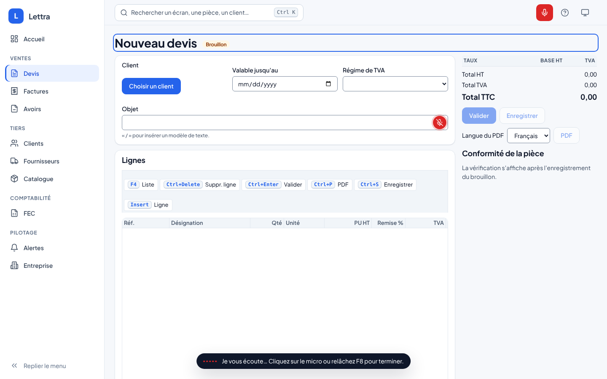
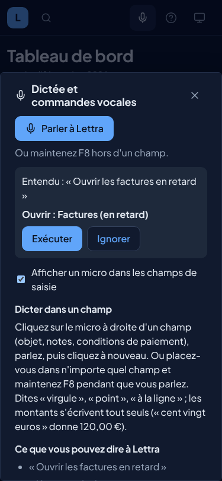

# Accompagnement, aide à la saisie et voix dans l'interface

Vague 5, lane F. Trois aides pour l'utilisateur, toutes dans `Lettra.UI.Shared`, donc identiques dans le navigateur
(PWA) et dans l'application MAUI : le tutoriel des premières fois, l'aide à la saisie au clavier, et la voix (dictée
et commandes) branchée sur le moteur Whisper local de `Lettra.Speech`. Aucune ne sort de donnée du cabinet de la
cellule ou du poste (ADR-0011, ADR-0012), et aucune n'appelle un service payant.

## 1. Tutoriel des premières fois

| Quoi | Comment |
|---|---|
| Démarrage | La première fois qu'un utilisateur ouvre un écran, une bulle le présente en 3 à 8 étapes. Elle ne revient plus ensuite, sauf si le parcours change de version. Rien ne démarre avant l'ouverture de la session : l'écran de connexion reste libre, et l'accueil se présente juste après la connexion. |
| Rejouer | Bouton **?** de la barre du haut (« Aide et tutoriels »), qui ouvre le panneau d'aide, puis « Tutoriel de cet écran » ; ou Ctrl+K puis « Tutoriel de cet écran ». |
| Tout revoir | Menu Apparence, **Réinitialiser les tutoriels** (ou Ctrl+K, « Réinitialiser les tutoriels »). |
| Clavier | Flèches gauche et droite pour reculer et avancer, Échap pour fermer, même si le focus n'est pas encore dans la bulle. |
| Écrans couverts | Accueil, devis (liste et éditeur), factures (liste et éditeur), clients, catalogue, FEC, synchronisation, alertes, et l'assistant IA à sa première ouverture. |
| Liste de démarrage | Sur le tableau de bord, « Pour bien démarrer » : fiche entreprise, premier client, premier devis, devis transformé en facture, export FEC. Chaque étape se coche toute seule d'après les données du dossier ; la liste disparaît quand tout est fait ou quand on la masque. |

Où c'est rangé :

- `Onboarding/TourCatalog.cs` décrit chaque parcours comme des données : identifiant, version, route, et pour chaque
  étape les éléments à montrer (`[data-tour='…']` d'abord, puis les identifiants existants). Un élément absent de
  l'écran n'empêche rien : la bulle se met au centre.
- Les textes sont dans `Localization/Modules/Accompagnement.resx` (FR) et `.en.resx` (EN), clés `Tour.<parcours>.<étape>.Title|Text`.
- Ce qui a été vu est gardé sur l'appareil, par utilisateur (`lettra.tours.<empreinte>` = `home:2;quotes:1`).
- Placement : sous l'élément s'il y a la place, sinon au-dessus, sinon à côté (menu latéral), sinon au centre ; sur
  téléphone (moins de 768 px), la bulle est une feuille en bas, ou en haut quand l'élément montré est en bas. Les
  zones sûres d'iOS sont respectées.
- Un élément caché dans un bloc replié (bouton `aria-expanded="false"` avec `aria-controls` sur un de ses parents) est déplié avant d'être montré.
- Pour ajouter une étape : une ligne dans `TourCatalog`, deux clés FR et deux clés EN, et **la version du parcours
  +1** pour que ceux qui l'ont déjà vu le revoient.
- Le tutoriel ne démarre jamais seul sous un navigateur piloté (Playwright, captures du design) : il couvrirait
  l'écran testé. Le bouton **?** marche partout.
- Il ne démarre pas non plus seul tant que la session n'est pas ouverte, ni sur l'écran de session (`TourHost` lit
  `SessionState` et repart quand la session s'ouvre). Sans cette garde, sur un vrai appareil (WebView Android, iOS,
  Windows, macOS, navigateur), la visite de l'accueil partait avant la lecture de la session, restait affichée sur
  l'écran de connexion et son voile captait le toucher sur « Se connecter ». Toutes les coques passent par le même
  `MainLayout` de `Lettra.UI.Shared`, donc la même garde.

## 2. Aide à la saisie sans la voix

| Où | Aide |
|---|---|
| Fiche client, code postal et ville | Taper le code postal propose les communes (« 69001 Lyon 1er Arrondissement ») ; taper le début de la ville propose ses codes. Choisir remplit les deux champs. Seulement pour la France (pays vide ou FR). 35 683 couples code et commune, outre-mer compris, chargés une fois. |
| Objet, notes, conditions de paiement | **« / »** ouvre les modèles de texte du champ (« /pena » propose « Pénalités de retard »). Ctrl+K, « Insérer : … », insère un modèle dans le dernier champ visité. Modèles : objets de mission, conditions de paiement, pénalités de retard et indemnité de 40 € (L441-10 et D441-5 du Code de commerce), validité et acceptation du devis, acompte, franchise de TVA (293 B du CGI), remerciements. |
| Texte libre | Correcteur orthographique du navigateur sur l'objet et les notes seulement (pas sur les codes ni les numéros). En sortie du champ : espaces doublés retirés, pas d'espace avant la virgule et le point, majuscule en tête (sauf si le premier mot contient un chiffre ou une majuscule, comme « m3 » ou « iPhone »). |
| Lignes de devis et de facture | Saisie rapide dans Quantité : `3h`, `1h30`, `45 min`, `1,5 j`, `2 jours`, `2x45`, `2x3h` ; l'unité passe à Heure ou Jour toute seule. Dans le prix : `2x45`, `1 234,50 €`. Un aperçu (« = 90,00 », « 1,5 j ») s'affiche pendant la frappe. **F4** sur la désignation propose celle du catalogue puis celles déjà écrites dans le dossier pour cet article. |
| Éditeurs de devis et de facture | Sous les lignes, les articles habituels du client (« Ajouter « Tenue comptable mensuelle » »), du plus fréquent au moins fréquent ; sur une facture sans conditions de paiement, « Reprendre ses dernières conditions ». |

Toutes les listes suivent le motif ARIA « combobox » : flèches pour parcourir, Entrée pour choisir, Échap pour
fermer, et le nombre de suggestions est annoncé au lecteur d'écran.

Où c'est rangé : `Typing/` (`SmartInput.razor` est le seul champ assisté, réutilisé partout ; `QuickEntry`,
`TextTidy`, `TextTemplates`, `PostalCodeDirectory`, `TypingHistory`) et les textes dans `Localization/Modules/Saisie.resx`.

L'historique du dossier (articles habituels, désignations, conditions) est lu dans le navigateur à partir des
40 dernières pièces, par les passerelles existantes. Une requête serveur dédiée serait plus légère sur un gros
dossier : c'est une suite possible côté module Facturation.

Mesures (tests `TypingLogicTests`) : une recherche de commune et une suggestion sur un dossier de 5 000 pièces
prennent moins de 100 ms.

Mise à jour des codes postaux : `npm pack codes-postaux@<version>`, `tar xzf codes-postaux-<version>.tgz`, puis
`node build/codes-postaux/generer.mjs package/codes-postaux.json`. La source et la licence sont dans
`wwwroot/data/codes-postaux.LISEZMOI.md` et `THIRD-PARTY-NOTICES.md`.

## 3. La voix dans l'interface

La voix est **un choix**. Tout reste faisable au clavier, et l'utilisateur peut masquer les micros.

| Quoi | Comment |
|---|---|
| Bouton micro de la barre du haut | Toujours visible. Il ouvre le panneau « Dictée et commandes vocales » : dit si la dictée marche ici, et sinon pourquoi ; bouton **Parler à Lettra** ; ce qu'on peut dire ; case « Afficher un micro dans les champs de saisie » (retenue sur l'appareil). Barré quand la voix est indisponible ou masquée. |
| Micro d'un champ | À droite de l'objet, des notes et des conditions de paiement. Un clic écoute (onde sonore en bas de l'écran), un second clic arrête ; le texte s'ajoute au curseur. Ponctuation dite (« virgule », « à la ligne ») et montants (« cent vingt euros » → 120,00 €) mis en forme par `Lettra.Speech`. |
| F8 maintenue | Dans un champ de texte : dicte dans ce champ. Hors d'un champ : commande vocale. |
| Commandes | Ouvrir une liste (« ouvrir les factures en retard »), créer (« nouveau devis »), chercher (« chercher le client Dupont », résultats de la palette), ajouter une ou plusieurs lignes à la pièce ouverte (« ajoute trois heures de conseil à 120 euros » ; un prix dit TTC est ramené en HT au taux de la ligne ; une désignation qui retrouve un article du catalogue prend sa référence et son prix), remise sur chaque ligne (« remise de dix pour cent »), devis dicté (« devis pour Dupont, deux jours d'audit à 900 euros » : le client est cherché, le brouillon s'ouvre avec ses lignes). |
| Garde-fous | Une commande est **toujours affichée avant d'être exécutée** (Exécuter ou Ignorer). « Valider » n'est jamais fait à la voix : le panneau renvoie au bouton Valider. « Enregistrer » rappelle que le brouillon s'enregistre seul. |
| Indisponible | Messages clairs : dictée non activée sur ce déploiement (avec la façon de l'activer), serveur injoignable (bouton Réessayer), moteur qui se prépare (modèle Whisper en téléchargement au premier démarrage : redemandé seul toutes les 15 s, le micro apparaît dès qu'il est prêt), page en `http://` sur une adresse du réseau (le navigateur ne donne le micro qu'en `https://` ou sur `http://localhost`), micro refusé, pas de micro, navigateur sans accès au micro, rien entendu, moteur qui ne répond pas. Les micros des champs n'apparaissent que si la voix marche. |
| Tutoriel | Une étape « Dicter au lieu de taper » dans les parcours de l'accueil, du devis et de la facture. |
| Palette | Ctrl+K : « Parler à Lettra » (F8), « Masquer les micros des champs » ou « Afficher les micros des champs ». |

Comment l'audio circule : `wwwroot/lettra-voice.js` enregistre le micro et produit un WAV PCM 16 bits mono 16 kHz,
remis à .NET ; `VoiceInput` l'envoie par `ISpeechGateway` (HTTP vers `POST /api/v1/voix/transcription` dans le
navigateur, en processus sur le poste MAUI) et insère le texte rendu. Rien n'est gardé dans le navigateur.

Où c'est rangé : `Voice/` (`VoiceInput` service, `VoiceCommands` registre des commandes par écran, `MicButton`,
`VoiceButton`, `VoiceHost`, `VoicePaletteProvider`) et `Localization/Modules/Dictee.resx`. Un écran qui sait exécuter
une commande s'inscrit dans `VoiceCommands` (la grille des lignes le fait pour « ajouter une ligne » et « remise »).

Activer la voix sur un déploiement : voir `src/Core/Lettra.Speech/README.md` (moteur whisper.cpp dans la cellule,
Whisper.net sur le poste). Sans moteur, le panneau l'explique et les champs n'ont pas de micro.

Ce qui n'est pas encore fait : le filtre dit avec une liste (« en retard ») est affiché mais pas encore appliqué à la
liste ouverte ; « annuler » ferme le panneau sans quitter le formulaire. Le texte entendu s'affiche à la fin de la
phrase, pas mot à mot : Whisper transcrit un enregistrement entier.

## 4. Ce qui est vérifié, et où

| Vérification | Où | Résultat |
|---|---|---|
| Tests bUnit : parcours, placement, mémoire et versions, liste de démarrage, champ assisté, modèles, codes postaux, saisie rapide, F4, habitudes du client, micro, panneau, F8, commandes, voix désactivée ou injoignable | CI, Linux | 351 tests de `Lettra.UI.Tests` verts |
| Latence des suggestions (commune, dossier de 5 000 pièces) | CI, Linux | moins de 100 ms (médiane de cinq, après un premier appel) |
| Parité des clés FR et EN | `Lettra.Architecture.Tests` | vert |
| Démo Docker, Chromium sans indicateur de navigateur piloté (`navigator.webdriver` faux, comme une WebView) : aucun voile de visite sur l'écran de session, visite « Bienvenue dans Lettra » affichée juste après la connexion Keycloak | Chromium, Linux, 1440 et 375 px | vérifié |
| Navigateur réel, application publiée (WASM) : tutoriel à 1440, 768 et 375 px (thème sombre au téléphone), Échap, mémoire après rechargement, bouton **?**, code postal vers ville, modèles « / » | Chromium (Playwright), Linux | vérifié |
| Voix dans Chromium avec un micro simulé : micro d'un champ, onde et texte inséré, F8 hors champ, commande affichée puis exécutée, WAV reçu par le serveur (RIFF, mono, 16 000 Hz, 16 bits) | Chromium, Linux, serveur de test à la place de l'API | vérifié à 1440 et 375 px |
| Démo Docker de bout en bout (Keycloak, API, application publiée) avec un serveur remplaçant whisper.cpp (mêmes routes, texte fixe) : statut `Ready: false` pendant le « chargement du modèle », panneau « La dictée se prépare » sans micro dans les champs, micro apparu seul 9 s après la fin du chargement, dictée dans l'Objet d'un nouveau devis (transcription 200, texte inséré) | Chromium, Linux, 1280 px | vérifié |
| Page ouverte en `http://` sur l'adresse IP du poste : `secureContext()` faux, pas d'accès au micro, message « https:// ou http://localhost » ; en `http://localhost:8080` le micro est accessible | Chromium, Linux | vérifié |
| Voix avec un vrai Whisper et une vraie voix | | non vérifié dans l'interface (le moteur l'est par le workflow « Voix » de lane D) |
| Safari, Firefox, Edge | | non vérifié |
| MAUI Windows, macOS, Android, iOS | | non vérifié : même code Razor ; le micro dans la WebView demande les autorisations natives que Socle ajoute avec `AddOnDeviceSpeech` |
