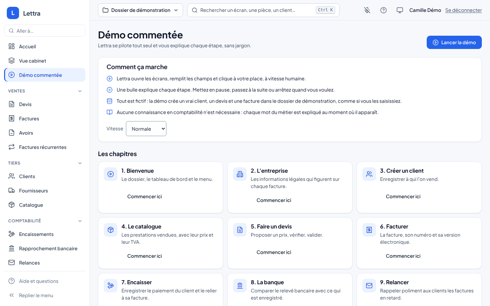
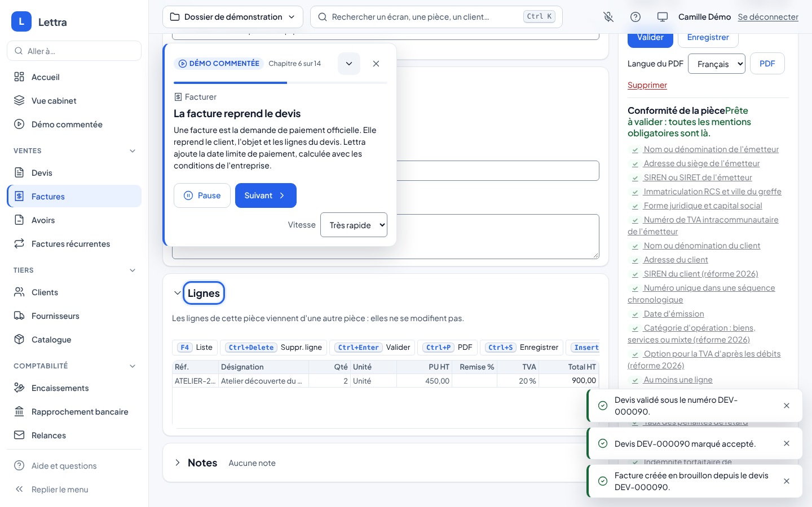
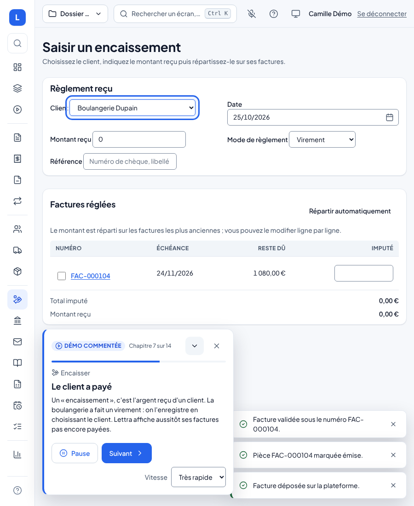
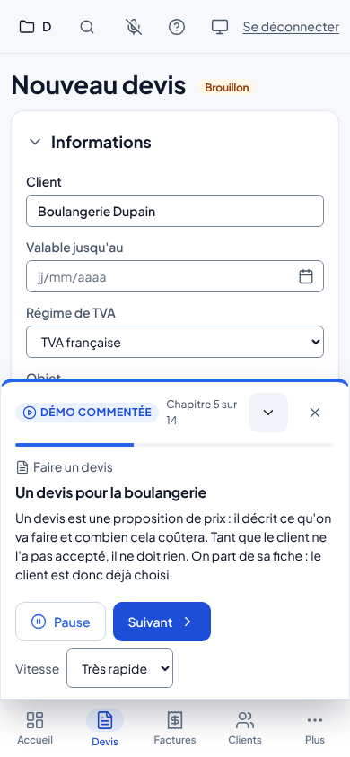
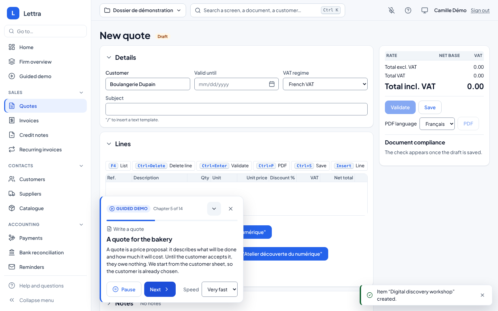

# Démo commentée

La démo commentée montre Lettra à quelqu'un qui ne connaît pas la comptabilité. Lettra se pilote tout seul : il ouvre
les écrans, tape les champs à vitesse humaine et clique les boutons, pendant qu'une bulle explique chaque étape avec
des mots simples. On regarde, on met en pause, on passe à la suite ou on arrête quand on veut.

Tout est dans `Lettra.UI.Shared` : même démo dans le navigateur (PWA, Linux compris) et dans l'application MAUI.

## La lancer

- Menu **Démo commentée** (sous Vue cabinet), panneau **Aide et questions** (« ? »), ou palette **Ctrl+K**
  (« Démo commentée : voir Lettra en action »).
- **Lancer la démo** part du début ; chaque chapitre a son bouton **Commencer ici**, sauf « Facturer », qui continue
  directement le devis accepté du chapitre précédent.
- La vitesse (lente, normale, rapide, très rapide) se choisit avant ou pendant la lecture.

La démo crée de vraies pièces dans le dossier ouvert (un client, un article, un devis, une facture, un encaissement),
exactement comme une saisie à la main. Elle n'est donc proposée que là où le jeu de démonstration est permis : hôte de
démonstration avec `Lettra:Demo:Seed=true`, jamais en environnement Production (même règle que le bouton « Charger les
données de démonstration » de l'accueil, lue par `IDemoDataGateway`). Ailleurs, l'écran explique pourquoi elle n'est
pas disponible. Chaque lecture tire un code court et un SIREN fictif valide : la démo se rejoue autant de fois qu'on
veut dans le même dossier sans buter sur une référence d'article ou un SIREN déjà pris.

## Le parcours

Quatorze chapitres, dans l'ordre où une entreprise utilise Lettra. Chaque terme du métier est expliqué au moment où il
apparaît (HT, TTC, TVA, SIREN, devis, avoir, lettrage, rapprochement, échéance, FEC…).

| Chapitre | Ce que Lettra fait | Ce que la bulle explique |
|---|---|---|
| 1. Bienvenue | Ouvre l'accueil | Le dossier (une entreprise suivie par le cabinet), le chiffre d'affaires HT, le menu |
| 2. L'entreprise | Ouvre la fiche entreprise | SIREN, numéro de TVA, conditions de paiement obligatoires sur les factures |
| 3. Créer un client | Crée « Boulangerie Dupain » (SIREN fictif, adresse à Lyon) | Pourquoi le SIREN du client est obligatoire avec la facture électronique |
| 4. Le catalogue | Ajoute « Atelier découverte du numérique » à 450 € HT | HT, TVA et TTC sur un exemple chiffré |
| 5. Faire un devis | Devis depuis la fiche client, objet, deux ateliers, validation, acceptation | Devis, lignes, totaux, contrôle des mentions obligatoires, numéro définitif |
| 6. Facturer | Facture depuis le devis, validation, QR code de paiement, marquée émise, déposée sur la plateforme (simulée) | Numérotation sans trou, facture non modifiable, avoir, Factur-X, plateforme agréée |
| 7. Encaisser | Saisit le virement de 1 080 € et le répartit sur la facture | Encaissement, lettrage |
| 8. La banque | Importe le relevé fictif | Rapprochement bancaire |
| 9. Relancer | Ouvre l'aperçu d'une relance (rien n'est envoyé) | Facture échue, niveaux de relance |
| 10. La comptabilité | Ouvre le journal puis la balance | Écritures au débit et au crédit, comptes 411, 706, 44571, 512 |
| 11. La TVA et les impôts | Ouvre la déclaration de TVA puis le calendrier fiscal | TVA collectée moins déductible, contrôles avant déclaration, échéances |
| 12. Le FEC | Ouvre l'export FEC | Le fichier remis en cas de contrôle fiscal |
| 13. Le cabinet comptable | Ouvre la vue cabinet, le radar de prévention, puis les tableaux de bord | La vue de l'expert-comptable sur tous ses dossiers, les dossiers à appeler, les indicateurs |
| 14. L'IA, à sa juste place | Ouvre la page « Bien utiliser l'IA de Lettra » | L'IA éteinte par défaut, ce qu'elle ne fait jamais, le registre des usages de l'IA |
| 15. Et maintenant ? | Revient à l'accueil | Récapitulatif, aide « ? » et Ctrl+K |

## La bulle

- Elle ne couvre pas l'écran (rien n'est assombri) : on voit Lettra travailler. Un anneau bleu entoure l'élément dont
  parle la bulle et un pointeur montre où Lettra clique.
- **Pause** / **Reprendre**, **Suivant** (sans attendre la fin de la lecture), **Vitesse**, **Réduire** et **Arrêter**
  (croix). La bulle reste affichée le temps de la lire : 55 ms par caractère, entre 4 et 16 secondes, divisé par la
  vitesse.
- Si un élément attendu n'apparaît pas (écran modifié, données inhabituelles), la démo s'arrête sur l'étape au lieu de
  continuer à l'aveugle et propose **Réessayer** ou **Passer l'étape**.
- Le lecteur d'écran entend chaque nouvelle bulle (titre et texte). Avec « réduire les animations », le pointeur et
  l'anneau ne bougent plus et le texte se tape d'un coup.
- Pendant la démo, les tutoriels des écrans ne se lancent pas : leur voile couvrirait les gestes de Lettra.

| Appareil | Bulle | Vérifié |
|---|---|---|
| Ordinateur (≥ 1200 px) | Carte en bas à gauche du contenu ; elle remonte en haut quand elle cacherait l'élément montré, loin des messages de confirmation (en bas à droite) | Oui, démo Docker à 1440 px |
| Tablette (768 à 1199 px) | Même carte, à côté du rail d'icônes | Oui, démo Docker à 900 px |
| Téléphone (< 768 px) | Feuille au-dessus des onglets, réductible ; l'écran défile pour garder l'élément montré au-dessus | Oui, démo Docker à 390 px |
| Application MAUI (Windows, macOS, Android, iOS) | Mêmes composants ; proposée si l'hôte permet le jeu de démonstration | Non vérifié |

Les textes existent en français et en anglais ; la démo suit la langue de l'écran, y compris pour ce qu'elle tape
(objet du devis, désignation de l'article).

## Comment c'est fait

- **Scénario en données** (`Demo/DemoScriptCatalog.cs`) : chapitres, étapes, élément montré et gestes (`Navigate`,
  `WaitFor`, `Type`, `Click`). Les gestes visent les `id` que les écrans portent déjà, les mêmes que les tests ; un
  écran qui change un `id` utilisé par la démo met le scénario à jour. Les textes sont dans
  `Localization/Modules/DemoCommentee[.en].resx` (`Demo.<chapitre>.<étape>.Title` et `.Text`). Une valeur tapée qui
  commence par `res:` est lue dans les ressources ; `{run}` et `{siren}` sont remplacés par les valeurs de la lecture
  (`DemoValues`).
- **Lecteur** (`DemoPlayer`, service de portée utilisateur) : joue les étapes, gère pause, « Suivant », vitesse,
  blocage et arrêt. Il ne connaît ni le navigateur ni les écrans : il passe par le port `IDemoDriver`.
- **Gestes du navigateur** (`JsDemoDriver` et `wwwroot/lettra-demo.js`) : de vrais événements de saisie et de clic,
  reçus par les écrans Blazor comme ceux d'un clavier et d'une souris ; la navigation passe par `NavigationManager`.
  Rien n'est simulé côté serveur : les pièces passent par les mêmes cas d'usage, droits et contrôles qu'une saisie
  normale.
- **Bulle** (`Demo/DemoHost.razor`, posée une fois dans `MainLayout`) et **écran** (`Pages/Demo/DemoPage.razor`,
  route `/demo`). Styles dans `wwwroot/lettra-demo.css`, uniquement avec les jetons du système de design.

Aucune route d'API n'a été ajoutée : la démo n'utilise que les écrans existants et `GET /api/v1/demo` (disponibilité du
jeu de démonstration).

## Tests

- `DemoPlayerTests` : ordre des gestes, jetons et ressources, pause, « Suivant », étape bloquée (réessayer, passer),
  arrêt, relance, vitesse, temps de lecture.
- `DemoScriptCatalogTests` : chaque chapitre et chaque étape ont leurs textes en français et en anglais, les valeurs
  `res:` existent, chaque chapitre ouvre une route connue, sauf celui qui continue le précédent.
- `DemoScreensTests` et `JsDemoDriverTests` (bUnit) : écran disponible ou non, chapitres, bulle et ses commandes,
  palette, appels au module JS.
- Vérification de bout en bout dans la démo Docker (Playwright, Chromium) : la démo entière jouée jusqu'à « Démo
  terminée » à 1440, 900 et 390 px, en français et en anglais, sans étape bloquée.
