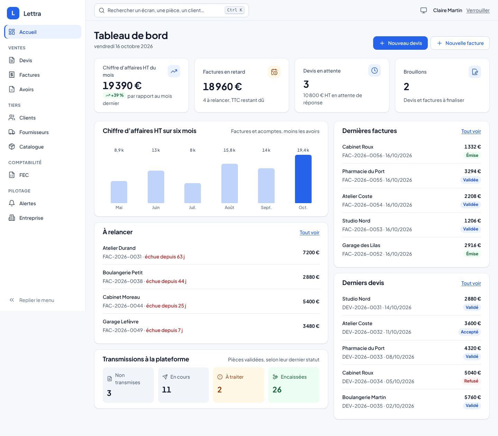
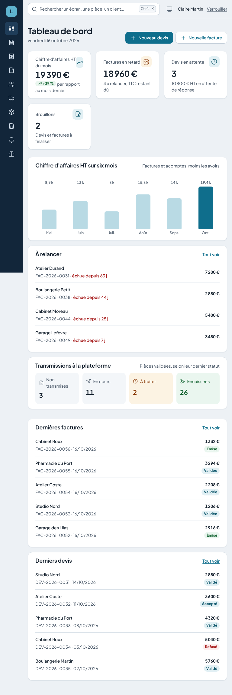
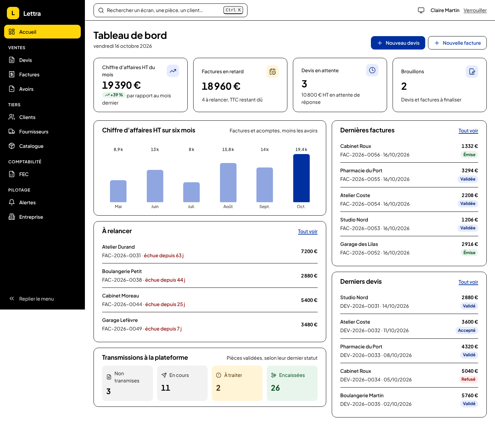
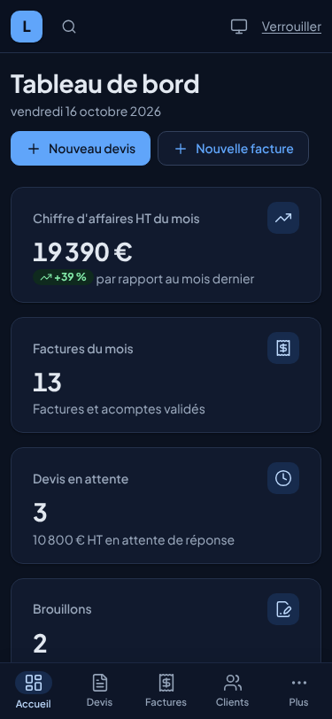
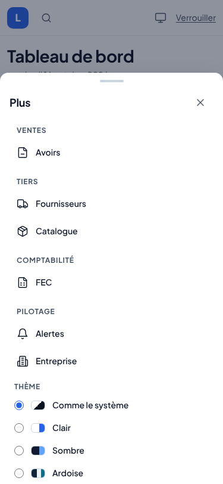
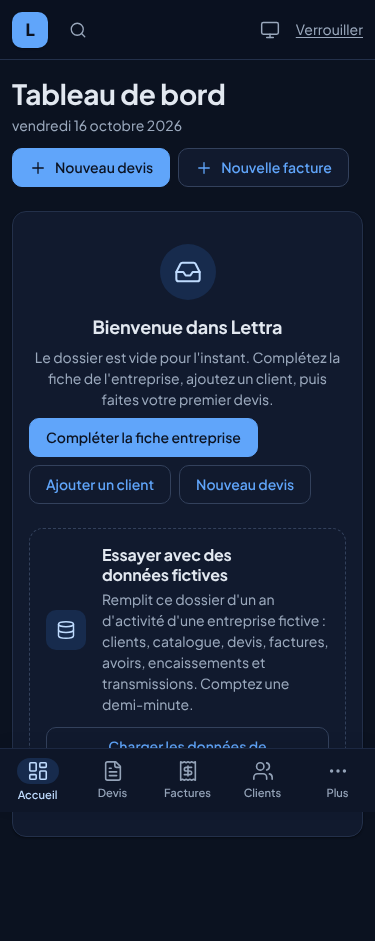
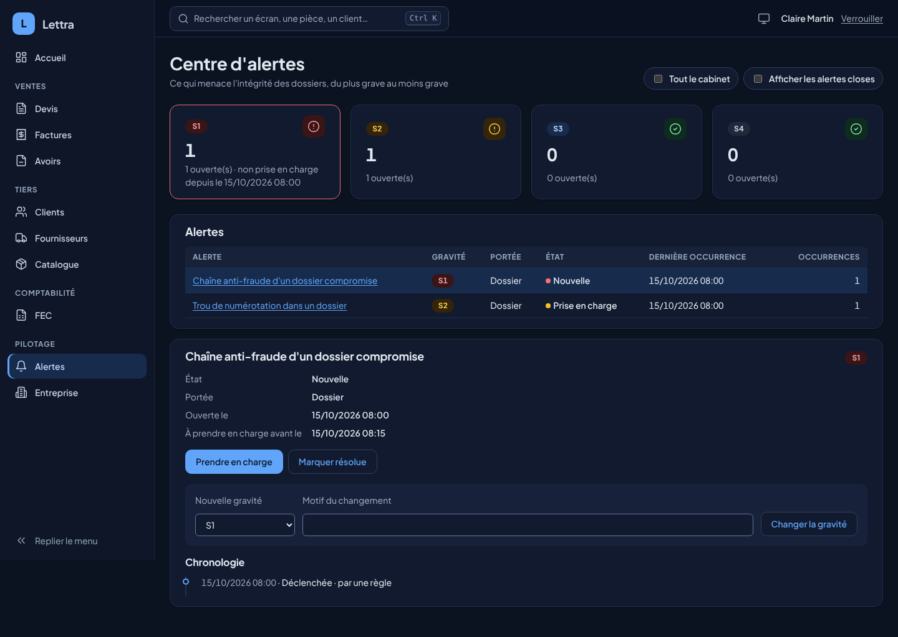
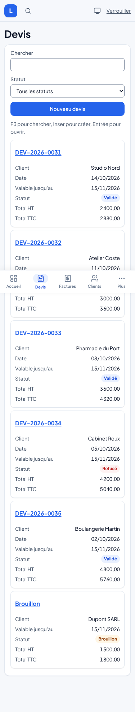
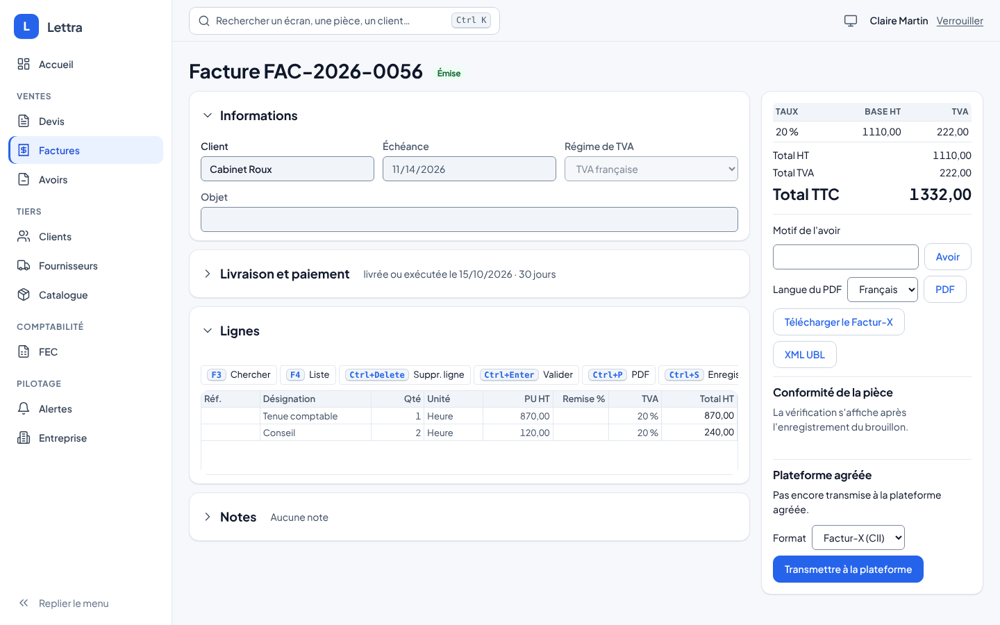
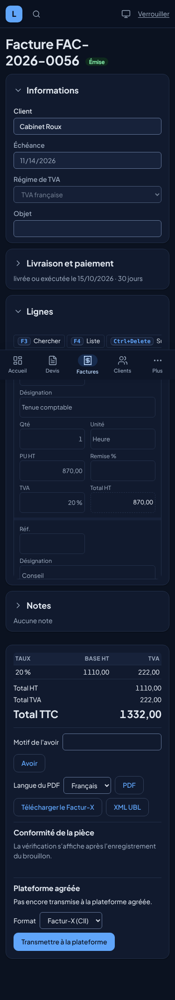

# Système de design de Lettra

Vague 5, lane B. Ce document décrit l'apparence commune de Lettra : jetons, thèmes, coque par appareil, tableau de
bord d'accueil, et comment le vérifier. Les écrans de la vague 5 (tutoriel, aide à la saisie, voix) s'appuient dessus.



## D'où il vient

Le système part de la recherche du skill **UI UX Pro Max** (version Basic,
https://github.com/nextlevelbuilder/ui-ux-pro-max-skill, licence MIT, voir `THIRD-PARTY-NOTICES.md`) :

```
search.py "B2B invoicing accounting firm SaaS dense professional" --design-system --density 8 --variance 3 --motion 3 -p "Lettra"
```

| Ce que le skill recommande | Ce que Lettra en garde |
|---|---|
| Style « Minimalism & Swiss Style » : sobre, fonctionnel, grille, contraste élevé | Gardé : cartes blanches, filets fins, une seule couleur d'action |
| Réglages : variance 3/10, mouvement 3/10, densité 8/10 (tableau de bord dense) | Gardé : échelle d'espacement de 4 px, animations de 140 à 220 ms |
| Couleurs : bleu de confiance `#2563EB`, accent orange `#EA580C`, fond `#F8FAFC`, texte `#1E293B` | Gardé pour le thème Clair ; l'orange reste rare (accent) |
| Typographie : Plus Jakarta Sans pour titres et texte | Gardé, servie avec l'application (pas de Google Fonts : hors ligne, RGPD) |
| À éviter : le sombre par défaut, les animations excessives | Clair par défaut, « Comme le système » au premier lancement ; mouvements réduits respectés |
| Liste de contrôle : icônes SVG (Lucide), focus visible, contraste 4,5:1, réponse à 375, 768, 1024 et 1440 px | Vérifiée par les tests et les captures (plus bas) |

Le motif de page « Hero + Features + CTA » du skill vise un site vitrine ; il ne s'applique pas à une application de
gestion et n'a pas été retenu.

## Jetons

Tout est dans `src/Presentation/Lettra.UI.Shared/wwwroot/lettra-tokens.css`, importé par `lettra.css` (les hôtes Web
et MAUI ne changent pas). Les composants n'emploient que ces variables, jamais une couleur en dur.

| Famille | Jetons | Rôle |
|---|---|---|
| Surfaces | `--color-bg`, `--color-surface`, `--color-surface-2`, `--color-border`, `--color-border-strong` | Fond de page, cartes, en-têtes de tableau, filets |
| Texte | `--color-fg`, `--color-fg-muted` | Texte courant et secondaire |
| Action | `--color-primary`, `--color-primary-hover`, `--color-on-primary`, `--color-primary-soft(-fg)`, `--color-focus` | Boutons, liens, sélection, anneau de focus |
| États | `--color-success/warning/danger/info/neutral` avec `-bg` et `-fg` | Pastilles de statut, messages |
| Champs | `--color-input-border` | Bordure de champ, au moins 3:1 sur la carte |
| Navigation | `--nav-bg`, `--nav-fg`, `--nav-fg-muted`, `--nav-active-bg`, `--nav-active-fg`, `--brand-mark` | Barre latérale, rail, onglets |
| Graphiques | `--chart-1`, `--chart-2` | Barres du tableau de bord |
| Typographie | `--font-sans`, `--text-xs` à `--text-2xl`, `--weight-*` | Plus Jakarta Sans variable, chiffres tabulaires dans les tableaux |
| Espace et forme | `--space-1` à `--space-6` (4 px de base), `--radius-sm/md/lg/full`, `--shadow-sm/md/lg` | |
| Mouvement | `--motion-fast`, `--motion-base`, `--ease-out` | À 0 ms sous `prefers-reduced-motion` |
| Gabarit | `--sidebar-w`, `--rail-w`, `--topbar-h`, `--tabbar-h`, `--hit` (44 px), `--safe-*` | Coque et zones sûres iOS |

Les anciennes variables `--lettra-*` restent en alias pour ne rien casser.

## Thèmes

| Thème | `data-theme` | Pour qui |
|---|---|---|
| Comme le système (défaut) | absent | Suit le clair ou le sombre de l'appareil |
| Clair | `light` | Bureau en journée |
| Sombre | `dark` | Écran en faible lumière ; le sombre du système reprend exactement ces valeurs |
| Ardoise | `slate` | Barre latérale bleu nuit, contenu clair : look « logiciel comptable » |
| Contraste élevé | `contrast` | Malvoyance, écran en plein soleil : texte à 7:1 au moins, focus jaune |

Le choix se fait dans le menu **Apparence** de la barre du haut (ou la feuille **Plus** sur téléphone, ou la palette
Ctrl+K, « Thème : … »). Il s'applique sans recharger (`applyTheme` dans `lettra-ui.js` pose `data-theme` sur `<html>`
et met à jour `theme-color`) et il est retenu sur l'appareil (`localStorage`, clé `lettra.theme`), comme la densité.
Au démarrage, `lettra-theme-boot.js`, chargé dans le `<head>` des hôtes, pose le thème retenu avant le premier rendu.

 

## Coque par appareil

| Largeur | Navigation | Barre du haut |
|---|---|---|
| ≥ 1200 px (ordinateur) | Barre latérale groupée (Ventes, Tiers, Comptabilité, Pilotage), repliable en rail, choix retenu | Recherche Ctrl K, assistant, synchronisation, apparence, session |
| 768 à 1199 px (tablette) | Rail d'icônes, libellés en info-bulle et pour le lecteur d'écran | Idem |
| < 768 px (téléphone) | Onglets en bas : Accueil, Devis, Factures, Clients, Plus ; la feuille **Plus** porte le reste et l'apparence | Marque, recherche en icône, actions |

La navigation est décrite une seule fois dans `Layout/NavItems.cs`. Cibles de 44 px sur écran tactile, zones sûres
(`env(safe-area-inset-*)`), lien « Aller au contenu », retour du focus et Échap pour fermer les panneaux.

 

## Tableau de bord d'accueil

`Pages/Home.razor`. Les figures du mois sont calculées par `Billing/DashboardFigures.cs` à partir des listes existantes :

- chiffre d'affaires HT du mois (factures et acomptes validés, moins les avoirs) et son évolution sur le mois précédent ;
- factures en retard : nombre et TTC restant dû (sans point des créances, le nombre de factures du mois à la place) ;
- devis en attente de réponse (validés, non expirés) et leur montant HT ;
- brouillons à finaliser ;
- histogramme des six derniers mois, doublé d'un tableau pour le lecteur d'écran ;
- « À relancer » : les cinq factures échues impayées les plus anciennes, avec leur retard en jours ;
- « Transmissions à la plateforme » : pièces non transmises, en cours, à traiter (rejetées, refusées, en litige,
  suspendues) et encaissées ;
- cinq dernières factures et cinq derniers devis.

Les retards et les transmissions viennent du **point des créances** (`GET /api/v1/receivables/summary`, permission
`DossierLire`), une lecture du module Exports : reste dû = TTC − avoirs validés − encaissements déclarés à la plateforme.
Une facture est en retard le lendemain de son échéance, à la date de Paris. Calcul : `ReceivablesSummary.Compute`.

Un dossier vide invite à compléter la fiche entreprise, ajouter un client et faire un premier devis. Quand l'hôte le
permet (`Lettra:Demo:Seed=true`, jamais en Production), il propose aussi **Charger les données de démonstration** :
un an d'activité fictive dans le dossier ouvert (`POST /api/v1/demo/seed`, droit d'émettre une facture ; sur le poste,
`AddDemoDataGateway`). Un second clic ne double pas le jeu.




## Composants des écrans

| Composant | Rôle |
|---|---|
| `ToastHost`, `ToastService` | Toaster en bas à droite (au-dessus des onglets sur téléphone). Une réussite disparaît après 6 s ; un avertissement ou une erreur reste jusqu'à ce qu'on le ferme. Trois au plus, sans doublon. |
| `StatusToast` | Annonce dans le toaster le résultat d'une action (pièce validée, fiche enregistrée, client créé) au lieu d'un message dans la page. |
| `GeneralErrors` | Erreurs sans champ (droits, serveur injoignable) dans le toaster. Elles se retirent quand la page réussit à nouveau ou se ferme. Les erreurs de champ restent sous leur champ. |
| `EmptyState` | État vide illustré : icône, ce qui manque, action principale. Une recherche sans résultat dit d'élargir les filtres. |
| `ListSkeleton` | Squelette de liste pendant le chargement, à la place du texte « Chargement… ». |
| `.lt-cards` | Sur téléphone, chaque ligne de tableau devient une carte. La première cellule sert de titre ; les autres se libellent par `data-label`. |
| `.lt-chips` | Filtres en pastilles (cases à cocher habillées). |
| `.lettra-form-grid` + `.lettra-field` | Formulaire en sections, champs sur plusieurs colonnes. Les actions restent collées en bas de l'écran (`.lt-form-actions`). |
| `Collapsible` | Bloc repliable : carte dont le titre est un bouton (`aria-expanded`). Replié, il montre un résumé d'une ligne ; son contenu reste rendu, une grille garde sa saisie. L'état choisi est retenu sur l'appareil, par bloc (`lettra.bloc.{Id}`). `ExpandAsync()` le déplie avant d'y placer le curseur. |

Toute création, modification ou suppression s'annonce dans le toaster : pièce créée, modifications enregistrées (un seul
message pendant la saisie, renouvelé à chaque enregistrement automatique), brouillon supprimé, facture ou avoir tiré
d'une pièce, transmission à la plateforme, encaissement déclaré, article créé ou archivé, client ou fournisseur créé,
fiche entreprise enregistrée, alerte prise en compte, résolue ou reclassée.

Les éditeurs de devis et de factures sont découpés en blocs repliables : Informations (client, échéance ou validité,
régime de TVA, objet), Livraison et paiement (factures : replié dès que la date de livraison est remplie), Lignes et
Notes (replié tant qu'il est vide). Un constat de la checklist déplie son bloc avant de placer le curseur. La grille des
lignes prend la hauteur de ses lignes, jusqu'à 60 % de l'écran, et sa barre de touches reste sur une ligne.

Les blocs apparaissent avec un léger mouvement à l'ouverture d'une page. Ce mouvement est supprimé quand l'appareil demande moins d'animations.






## Vérifier

| Quoi | Comment |
|---|---|
| Contrastes WCAG de chaque thème (texte 4,5:1, 7:1 en contraste élevé ; bordures et focus 3:1) | `ThemeContrastTests`, lit `lettra-tokens.css` |
| Le sombre du système identique au sombre choisi, mêmes jetons dans chaque thème | `ThemeContrastTests` |
| Navigation, onglets, feuille Plus, thème appliqué et retenu, rail retenu, palette | `ShellTests` (bUnit) |
| Chiffres du tableau de bord | `DashboardFiguresTests`, `ShellTests` |
| Point des créances (retards, transmissions) | `ReceivablesSummaryTests`, `ReceivablesApiTests`, `GatewayParityTests` |
| Bouton des données de démonstration, refus en Production et sans droit | `ShellTests`, `ReceivablesApiTests` |
| Cellules de la grille à la hauteur de leur ligne | `GridCellTests` |
| Bloc repliable (bouton, résumé, état retenu) ; blocs des éditeurs ; toaster à l'enregistrement et à la suppression | `CollapsibleTests`, `QuoteEditorTests` |
| Un champ (liste comprise) tient dans sa colonne ; la grille des lignes tient sans défilement dès 720 px et ne rogne aucune cellule | `GridCellTests`, `QuoteEditorTests` ; banc navigateur de 375 à 1920 px, densités Expert et Confort |
| Rendu à 375, 768 et 1440 px dans chaque thème, audit axe (WCAG 2.2 AA), aucun défilement horizontal | Galerie + Playwright, ci-dessous |

```bash
LETTRA_GALLERY_DIR=$PWD/artifacts/galerie dotnet test tests/Lettra.UI.Tests --filter Galerie
NODE_PATH=$(npm root -g) node build/design-captures.cjs artifacts/galerie chemin/vers/axe-core/axe.min.js
```

La galerie rend 12 écrans avec des données fictives dans les 4 thèmes : accueil, menu apparence, feuille Plus, devis,
factures, une facture, clients, articles, centre d'alertes, fiche entreprise, accueil d'un dossier vide et devis sans
résultat. Le script en tire 144 captures et `audit.json`. Au 16 octobre 2026 : 0 défaut axe, aucun débordement horizontal. Limites : pages rendues sans JavaScript (la grille de saisie y est statique), Chromium
seulement ; Safari et les vrais téléphones ne sont pas testés ici.

## Ajouter un écran ou un composant

1. Une entrée dans `NavItems.All` (libellé `Nav.*` dans les ressources) ; `ShellTests` vérifie que la route existe.
2. Des couleurs uniquement par jetons ; une nouvelle paire texte sur fond se déclare dans `ThemeContrastTests`.
3. Une icône Lucide de plus : recopier son SVG du paquet `lucide-static` dans `Components/IconPaths.cs`.
4. Ajouter l'écran à la galerie si son apparence compte.

## Licences

- UI UX Pro Max : MIT, outil de conception, rien n'est embarqué.
- Plus Jakarta Sans : SIL Open Font License 1.1, `wwwroot/fonts/OFL-plus-jakarta-sans.txt`.
- Lucide : ISC (portions Feather, MIT), tracés dans `Components/IconPaths.cs`.

Les trois figurent dans `THIRD-PARTY-NOTICES.md`.
