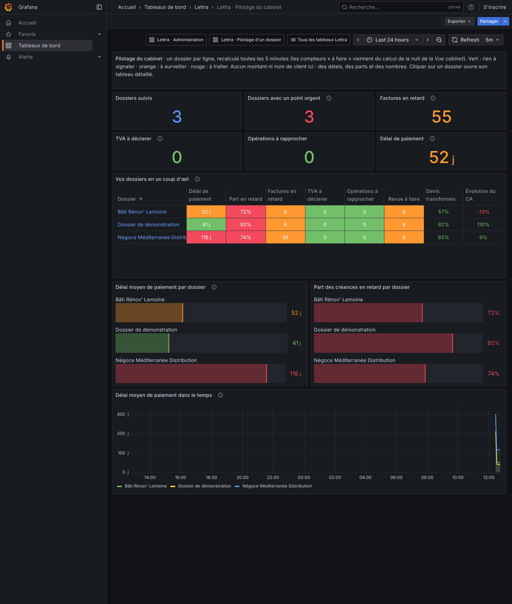

# Indicateurs de pilotage dans Grafana

Grafana montrait jusqu'ici la santé technique de Lettra (requêtes, erreurs, objectifs de service). Trois tableaux de
bord s'ajoutent pour aider les personnes qui utilisent et administrent Lettra :

| Tableau | Pour qui | Ce qu'il dit |
|---|---|---|
| **Lettra · Pilotage du cabinet** (`lettra-pilotage-cabinet`) | responsables du cabinet | tous les dossiers d'un coup d'œil : délai de paiement des clients, créances en retard, TVA à déclarer, banque à rapprocher, points urgents ; un clic sur un dossier ouvre le tableau du dossier |
| **Lettra · Pilotage d'un dossier** (`lettra-pilotage-dossier`) | responsables du cabinet, collaborateur du dossier | clients et encaissements, activité commerciale mois par mois, devis, et ce qui reste à faire |
| **Lettra · Administration** (`lettra-administration`) | administrateurs | erreurs et lenteurs de l'API, connexions refusées, alertes graves, envois en attente, postes qui ne se synchronisent plus, comptes, dossiers, place occupée, fraîcheur des calculs automatiques |

Chaque tableau commence par un court texte d'aide, chaque chiffre a une bulle « i » qui l'explique, et les couleurs
suivent la même règle partout : vert, tout va bien ; orange, à surveiller ; rouge, à traiter.



## Les indicateurs

### Ventes et encaissements (par dossier)

Calculés dans la base du dossier sur les pièces validées (jamais les brouillons), en jours calendaires de Paris.

| Indicateur | Métrique | Calcul |
|---|---|---|
| Délai moyen de paiement (DSO) | `lettra_kpi_dso_days` | reste à encaisser TTC ÷ ventes TTC des 90 derniers jours × 90. Absent s'il reste un dû sans aucune vente récente (le chiffre n'aurait pas de sens) ; 0 si rien n'est dû |
| Part des créances en retard | `lettra_kpi_overdue_receivables_ratio` | créances échues ÷ reste à encaisser |
| Encaissé sur 12 mois | `lettra_kpi_collection_ratio` | encaissé ÷ dû sur les factures et acomptes des 12 derniers mois (avoirs imputés déduits) |
| Évolution du chiffre d'affaires | `lettra_kpi_revenue_trend_ratio` | CA HT des 3 derniers mois complets ÷ CA HT des 3 mois d'avant − 1 |
| Activité mois par mois | `lettra_kpi_revenue_index{month}` | CA HT du mois en indice : 100 = mois moyen des 12 derniers mois |
| Factures émises par mois | `lettra_kpi_invoices_issued{month}` | factures et acomptes (hors avoirs) des 12 derniers mois |
| Clients actifs | `lettra_kpi_active_customers` | clients facturés dans les 12 derniers mois |
| Poids du premier client | `lettra_kpi_top_customer_share_ratio` | CA HT du premier client ÷ CA HT total sur 12 mois |
| Devis transformés | `lettra_kpi_quote_conversion_ratio` | (acceptés + facturés) ÷ (acceptés + facturés + refusés + expirés) sur 12 mois |
| Devis en attente | `lettra_kpi_quotes_pending` | devis validés, pas encore expirés |
| Devis qui expirent sous 7 jours | `lettra_kpi_quotes_expiring_soon` | parmi les devis en attente |

Les avoirs viennent en déduction du chiffre d'affaires. Le montant encaissé d'une facture est le plus grand entre le
paiement saisi et les encaissements signalés par la plateforme agréée ; une facture refusée par l'acheteur sur la
plateforme n'est plus une créance à suivre, mais sa vente compte toujours dans l'activité.

### Vue cabinet (par dossier)

Le tableau du cabinet reprend les compteurs du calcul de nuit de la [Vue cabinet](vue-cabinet.md), sans les recalculer :
`lettra_kpi_cabinet_indicator_count{key}`, `_level{key}` (0 rien, 1 en attente, 2 à traiter, 3 urgent), `_due_days{key}`
(jours avant l'échéance, négatif en retard) et `_age_seconds` (âge du dernier calcul). Les clés sont celles de la Vue
cabinet (`factures.retard`, `pa.rejets`, `alertes.ouvertes`, `revue.a-faire`, `tva.a-declarer`, `banque.non-rapprochee`).

### Administration

| Indicateur | Métrique |
|---|---|
| Place occupée par dossier | `lettra_kpi_database_size_bytes` (SQLite : pages × taille de page ; PostgreSQL : tables du schéma ; SQL Server : fichiers de la base) |
| Postes par état, postes silencieux (plus de 7 jours), plus long silence | `lettra_kpi_devices{state}`, `lettra_kpi_devices_silent`, `lettra_kpi_device_oldest_sync_age_seconds` |
| Comptes par état, dossiers par état | `lettra_kpi_accounts{state}`, `lettra_kpi_dossiers{state}` (catalogue) |
| Alertes ouvertes par gravité | `lettra_kpi_open_alerts{severity}` (S1 à S4, nouvelles ou prises en charge) |
| Santé de la collecte | `lettra_kpi_collect_duration_seconds`, `lettra_kpi_collect_failures`, `lettra_kpi_collected_at_seconds` |

Le tableau d'administration reprend aussi les métriques OpenTelemetry déjà en place (requêtes, erreurs 5xx, temps de
réponse, connexions, outbox) et renvoie vers « Activité technique détaillée » et « Objectifs de service ».

## Aucun montant ne sort du dossier

Les indicateurs publiés sont des **ratios, des délais, des indices et des compteurs**, jamais un montant en euros, un
nom de client ou une donnée personnelle. Les montants restent dans la base du dossier (ADR-0003, annexe F) ; le
chiffre d'affaires est donc donné en indice (100 = mois moyen) et le poids du premier client en pourcentage, sans dire
qui il est. Seuls le nom du dossier et celui du cabinet apparaissent, pour que les tableaux soient lisibles.

## Comment les chiffres arrivent dans Grafana

```
API Lettra ── GET /internal/kpi/metrics (Bearer) ──► Prometheus de la cellule ──► Grafana
   │
   └─ toutes les 5 min : pour chaque dossier actif du catalogue, ouvre sa base
      (sources IDossierKpiSource), puis catalogue et alertes (ICellKpiSource)
```

- **Hors OpenTelemetry.** La télémétrie OTel ne porte aucune donnée de dossier et peut quitter la cellule (annexe G).
  Ces indicateurs, eux, restent dans la cellule : l'API les expose au format texte Prometheus sur
  `/internal/kpi/metrics`, lu par le Prometheus de la cellule (tâche `lettra-kpi`).
- **Fermé par défaut.** La route n'existe que si un jeton est réglé ; Prometheus le présente en `Authorization: Bearer`.
  Le jeton est comparé en temps constant ; sans lui, réponse 401.
- **Calcul en cache.** La collecte ouvre chaque base de dossier ; elle est gardée en mémoire le temps de
  `RefreshInterval` et une seule tourne à la fois. Un dossier illisible ne bloque pas les autres : il est compté dans
  `lettra_kpi_collect_failures`.

Réglages (`Lettra:Kpi`) :

| Clé | Défaut | Rôle |
|---|---|---|
| `ScrapeToken` | vide (route absente) | jeton attendu de Prometheus ; en production, un secret de la cellule |
| `RefreshInterval` | `00:05:00` | durée de vie d'une collecte |
| `BusinessIndicators` | `true` | `false` retire de la publication vers Prometheus les indicateurs de ventes, de devis et les compteurs de la Vue cabinet (par exemple en SaaS, si l'éditeur exploite Grafana et ne doit pas voir l'activité des clients) ; l'administration reste. Les tableaux de bord dans Lettra, eux, gardent tous les indicateurs : chacun n'y voit que ses dossiers |

Code : ports dans `Lettra.Application/Abstractions/Kpi`, calcul pur dans `Features/Kpi/BillingKpis.cs`, lecture des bases
dans `Lettra.Infrastructure.Persistence/Kpi`, collecte dans `Lettra.Infrastructure.Catalog/Kpi`, format Prometheus dans
`Lettra.Infrastructure.Observability/KpiExposition.cs`, route dans `Lettra.Api/Endpoints/KpiEndpoints.cs`. Les tableaux
sont générés comme du code dans `deploy/helm/lettra-observability/dashboards/` : la démo les monte, et le chart Helm les
publie dans sa ConfigMap.

## Dans la démo

Avec l'observabilité (voir le README), ouvrir http://localhost:3000, dossier **Lettra**. Le tableau du cabinet
liste les trois dossiers de démonstration ; cliquer sur un nom ouvre son tableau, ou choisir le dossier en haut du
tableau du dossier. Les courbes dans le temps se remplissent au fil des collectes (une par minute dans la démo, qui règle
`Lettra__Kpi__RefreshInterval: "00:01:00"` ; toutes les 5 minutes par défaut).

Vérifié dans la démo Docker, après la mise à jour d'une démo existante (les données de démonstration sont conservées) :
route 401 sans jeton et 200 avec, cible Prometheus `lettra-kpi` active, aucune collecte en échec, et les trois tableaux
sans panneau vide ni défilement de côté à 390 px (téléphone), 820 px (tablette) et 1440 px (ordinateur). Sur
téléphone, Grafana empile les panneaux sur une colonne et les tableaux défilent de côté dans leur cadre.

## Ce que Grafana fait mal pour des personnes non techniques

- **Pas de droits par dossier.** Lettra donne à chaque personne des droits dossier par dossier (catalogue) ; Grafana ne
  les connaît pas. Grafana OSS ne sait pas filtrer les données d'un tableau selon la personne connectée : qui ouvre le
  tableau du cabinet voit tous les dossiers. Ces tableaux sont donc **pour les responsables du cabinet et les
  administrateurs**. Un collaborateur limité à quelques dossiers reste sur la **Vue cabinet** de Lettra, qui applique
  ses droits, et sur le menu **Tableaux de bord**, qui montre les mêmes indicateurs filtrés par ses droits.
- **Connexion séparée.** Grafana a ses propres comptes ; en production, il faut le brancher sur Keycloak (OIDC) et
  réserver l'accès aux rôles de responsable et d'administrateur. La démo garde l'accès anonyme en lecture.
- **Un outil de plus.** Grafana est en anglais par endroits (sélecteur de période, menus), ses menus sont pensés pour
  des techniciens, et un clic sur un chiffre n'ouvre pas la pièce dans Lettra. Les textes d'aide, les bulles et les
  couleurs atténuent cela ; pour un usage quotidien par tous, les mêmes indicateurs sont aussi **dans Lettra**
  (menu « Tableaux de bord », voir [tableaux-de-bord.md](tableaux-de-bord.md)), avec les droits de chacun.
- **Données à 5 minutes près.** Les chiffres viennent d'une collecte périodique, pas de l'écran en direct.

## Limites et suite

- **Production.** Avec plusieurs répliques de l'API, chacune collecterait : soit Prometheus ne lit qu'une réplique,
  soit la collecte passe dans le Worker. Le `ServiceMonitor` Helm de la tâche `lettra-kpi` et l'OIDC de Grafana
  restent à écrire.
- **Seuils.** Les seuils de couleur (DSO orange à 45 jours, rouge à 60 ; créances en retard orange à 20 %, rouge à
  40 %…) sont des valeurs de départ à revoir avec un expert-comptable.
- **Montants.** Afficher des euros demanderait de faire sortir des montants de la base du dossier ; ce n'est pas fait
  volontairement.
