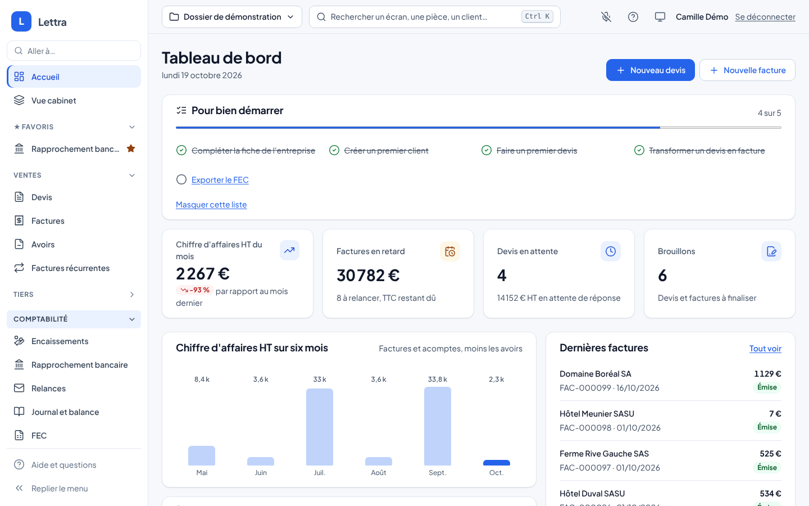
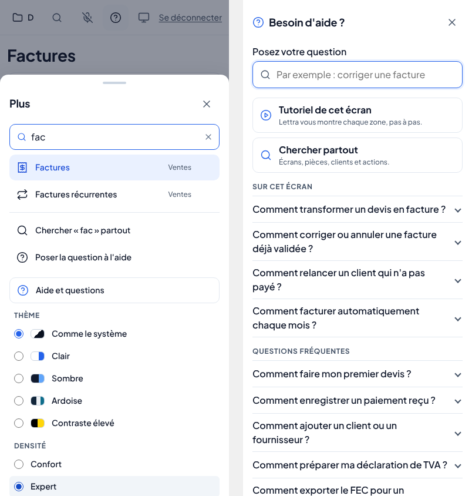

# Menu réglable et aide

Le menu de Lettra se règle à la façon de chacun et l'aide répond aux questions de qui s'y perd, sans IA. Tout est dans
`Lettra.UI.Shared` : même comportement dans le navigateur (PWA, Linux compris) et dans l'application MAUI (Windows,
macOS, Android, iOS).

## Ce que voit l'utilisateur

- **Plus de barre horizontale** : seule la liste des écrans défile, en hauteur. Un libellé trop long se termine par
  « … » (le nom entier est dans l'info-bulle). L'aide et « Replier le menu » restent en bas, hors de la liste.
- **Sections repliables** : un clic sur le titre d'une section (Ventes, Tiers, Comptabilité, Pilotage) la replie ou la
  déplie ; son chevron tourne. Une section repliée qui contient l'écran affiché porte un point bleu.
- **Favoris** : l'étoile, au survol d'un écran (toujours visible au doigt), l'épingle dans la section **Favoris**, sous
  Accueil et Vue cabinet. Une seconde touche le retire.
- **Recherche « Aller à… »** en haut du menu : quelques lettres suffisent, sans accents ni majuscules, et les mots
  courants comptent aussi (« tva » trouve Déclarations, « impayé » trouve Relances, « banque » le rapprochement).
  Chaque résultat rappelle sa section. **Entrée** ouvre le premier, **Échap** efface. Quand le menu ne suffit pas,
  « Chercher « … » partout » ouvre la palette Ctrl+K avec ce qui est tapé (pièces, clients, actions) et « Poser la
  question à l'aide » ouvre l'aide sur cette question.
- **Aide et questions** (bas du menu, bouton « ? » de la barre du haut, feuille « Plus » du téléphone, palette Ctrl+K) :
  - un champ « Posez votre question » qui comprend le langage courant (« je veux annuler ma facture ») et montre la
    meilleure réponse dépliée, avec un bouton vers l'écran qui répond ;
  - les questions de l'écran affiché en tête (« Sur cet écran »), puis toutes les questions fréquentes ;
  - « Tutoriel de cet écran », « Chercher partout », les raccourcis utiles et « Revoir tous les tutoriels » ;
  - « Demander à l'assistant » seulement si le cabinet a activé l'assistant IA (désactivé par défaut) : la question lui
    est passée telle quelle. L'aide marche entièrement sans lui.
- **Mémoire** : sections repliées et favoris sont rangés dans le compte et suivent l'utilisateur sur ses autres
  appareils ([preferences-utilisateur.md](preferences-utilisateur.md)). Sans compte (poste isolé, serveur plus ancien),
  ils restent sur l'appareil, **par utilisateur** (deux personnes sur le même poste ont chacune leur menu), dans le
  stockage local du navigateur ou du WebView MAUI. Ce n'est jamais une donnée de dossier.

| Appareil | Menu | Aide |
|---|---|---|
| Ordinateur (≥ 1200 px) | Barre latérale complète : recherche, Favoris, sections repliables ; repliable en rail | Volet à droite |
| Barre repliée, tablette (768 à 1199 px) | Rail d'icônes : toutes les icônes restent visibles (sections séparées par un filet), la loupe ouvre Ctrl+K | Volet à droite |
| Téléphone (< 768 px) | Onglets du bas ; la feuille **Plus** a sa recherche (qui couvre aussi les onglets), ses sections, ses favoris et l'aide | Plein écran |

## Accessibilité

- Le titre de chaque section est un bouton avec `aria-expanded` et `aria-controls` ; l'étoile porte `aria-pressed` et
  un nom complet (« Épingler Catalogue dans les favoris »).
- La recherche du menu annonce le nombre d'écrans trouvés (`role="status"`) ; l'aide annonce le nombre de réponses.
- L'aide est un `dialog` modal : le focus va dans la question à l'ouverture, Échap ferme. Les réponses sont des
  `
` natifs (clavier et lecteur d'écran sans script).
- Cibles de 44 px au doigt, mouvements réduits respectés, aucune couleur en dur (jetons de `lettra-tokens.css`).

## Pour les développeurs

| Quoi | Où |
|---|---|
| Entrées du menu (une ligne par écran), section, droit qui la cache | `Layout/NavItems.cs` |
| Mots-clés de la recherche du menu | ressource `<clé du libellé>.Keywords`, facultative (`Localization/Modules/Aide.resx`) |
| Recherche du menu (libellé d'abord, puis mots-clés) | `Layout/NavSearch.cs` |
| Sections repliées et favoris, par utilisateur et par appareil | `Layout/NavMenuState.cs` (clés `lettra.nav.sections.<empreinte>` et `lettra.nav.favorites.<empreinte>`) ; reliés au compte par `Preferences/PreferencesSync.cs` |
| Menu (barre latérale et feuille « Plus ») | `Layout/NavMenu.razor` |
| Questions fréquentes (écrans concernés, lien) | `Onboarding/HelpCatalog.cs` ; textes `Help.Faq.<id>.Question`, `.Answer`, `.Keywords` |
| Panneau d'aide, état partagé, entrée de la palette | `Onboarding/HelpPanel.razor`, `HelpPanelState.cs`, `HelpPaletteProvider.cs` |
| Empreinte de l'utilisateur pour les clés locales (partagée avec les tutoriels) | `Services/UserStorageKey.cs` |
| Styles | `wwwroot/lettra-nav.css` (importé par `lettra.css`) |

**Ajouter un écran au menu** : une ligne dans `NavItems.All` (avec `Page:` si un droit doit le cacher), son libellé
`Nav.*` et, si des mots courants le désignent, `Nav.*.Keywords` en français et en anglais.

**Ajouter une question à l'aide** : une ligne dans `HelpCatalog.All` (écrans où elle remonte, lien facultatif vers
l'écran qui répond) et ses trois textes en français et en anglais. Un test vérifie que chaque texte existe dans les
deux langues et que chaque lien mène à un écran existant. En français, espace insécable avant « ? », « : », « ! » et
dans les guillemets.

## Tests

| Quoi | Test |
|---|---|
| Pas de barre horizontale (styles), aide et repli hors de la liste | `NavMenuTests` |
| Sections : chevron, `aria-expanded`, mémoire par utilisateur, point de l'écran affiché | `NavMenuTests` |
| Favoris : épingler, retirer, relire, ignorer un écran disparu | `NavMenuTests`, `NavLogicTests` |
| Recherche : accents, mots-clés, ordre, Entrée, Échap, palette, aide, feuille « Plus » | `NavMenuTests`, `NavLogicTests` |
| Aide : ouverture, Échap, questions de l'écran, langage courant, lien, tutoriel, palette, toaster, assistant activé ou non | `HelpPanelTests` |
| Textes dans les deux langues, liens vers des écrans existants | `HelpPanelTests` |
| Rendu à 375, 768 et 1440 px dans chaque thème | `GalleryTests.Galerie_du_menu_et_de_l_aide_pour_les_captures` + `build/design-captures.cjs` |

Vérifié aussi dans la démo navigateur (Docker, Chromium) : aucune barre horizontale à 1440, 820 et 390 px, réglages
retenus après rechargement, recherche et Entrée, palette, aide, tutoriel, feuille « Plus », console sans erreur après
connexion.
