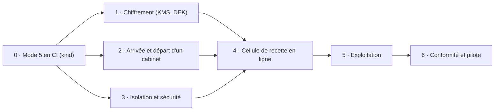

# Plan de développement du mode 5 : la cellule en ligne (SaaS)

> **Statut : en cours.** Étapes 0, 1 et 2 faites (sauf les points marqués « reste ») ; étapes 3 à 6 à faire. Il ne remplace
> pas les ADR (0002, 0008, 0009, 0011) ni les annexes E et F du blueprint : là où il les contredit, ce sont eux qui
> font foi, et le point est à trancher en revue.

## 1. Le but, en deux phrases

Un cabinet d'experts-comptables s'inscrit, se connecte et travaille sur ses dossiers **sans rien installer**, sur
des serveurs exploités par Lettra. Chaque dossier garde **sa propre base PostgreSQL**, **chiffrée par Lettra**,
et un cabinet ne peut jamais voir les données d'un autre.

Ce que « fini » veut dire est détaillé au § 6 (critères de sortie).

---

## 2. Ce qui existe déjà

Le mode 5 n'est pas à construire de zéro : l'essentiel des briques est dans le code. Ce qui manque, c'est
surtout **les assembler, chiffrer, exploiter et prouver**.

| Brique | État | Où |
|---|---|---|
| Mode `HostedSaaS` et composition (PostgreSQL, Catalog, Keycloak, supervision, synchronisation) | ✅ Codé | `src/Composition/Lettra.Bootstrap/LettraBootstrap.cs` |
| Registre Catalog : cabinets, clusters, dossiers, droits, règles, préférences | ✅ Codé, migrations sur 3 providers | `src/Infrastructure/Lettra.Infrastructure.Persistence/Catalog/` |
| Création d'une base par dossier, reprise si interruption, choix du cluster le moins rempli | ✅ Codé | `src/Infrastructure/Lettra.Infrastructure.Catalog/CatalogDossierProvisioner.cs` |
| Migration des bases de dossiers par le Worker (pas au démarrage de l'API) | ✅ Codé | `DossierMigrationOrchestrator.cs`, `src/Hosts/Lettra.Worker/` |
| Hiérarchie de clés : KEK du cabinet → DEK du dossier (AES-256-GCM) | ✅ La DEK chiffre les champs sensibles côté serveur (IBAN, e-mails) : voir [cles-et-chiffrement.md](cles-et-chiffrement.md) | `Security/DossierKeyring.cs`, `Sqlite/Local/LocalDossiers.cs` |
| KEK des cabinets | ✅ Tenues par le moteur Transit d'OpenBao (`TransitKekStore`), enveloppées dans le catalogue, réenveloppées chaque jour par le Worker ; configuration hors cellule | `Lettra.Infrastructure.Catalog/TransitKekStore.cs`, `SecretSources.cs` (`ConfigurationKekStore`) |
| Chart Helm de cellule (API, Worker, Keycloak, CloudNativePG, PgBouncer, Redis, tailles S à XL) | ✅ Écrit | `deploy/helm/lettra-cell/` |
| Infrastructure OVHcloud (cluster Kubernetes, réseau, stockage S3) et amorçage Argo CD | ✅ Écrit, non appliqué | `deploy/opentofu/`, `deploy/argocd/` |
| Cellule de recette en `HostedSaaS`, sauvegardes S3 | ⚠️ Décrite, **jamais déployée** | `deploy/cells/recette/values.yaml` |
| Essai en CI dans kind | ✅ Le mode 5 est essayé de bout en bout (`essai-mode5.sh`, job `mode5-kind`) ; Keycloak seul en mode 2 reste essayé par `essai-keycloak.sh` | `deploy/tests/kind/` |
| Arrivée et départ d'un cabinet | ✅ Par l'administrateur de la plateforme, écran « Plateforme » et API : voir [plateforme.md](plateforme.md). Le script reste pour les modes 2 et 3 | `Lettra.Infrastructure.Catalog/CatalogCabinetLifecycle.cs`, `deploy/keycloak/ajouter-cabinet.sh` |
| Observabilité (Prometheus, Loki, Tempo, Grafana, alertes) | ✅ Écrite, vérifiée sur la démo | `deploy/helm/lettra-observability/`, `deploy/cells/_commun/` |
| Suppression d'un dossier ou d'un cabinet | ✅ Effacement d'un dossier (délai de rétractation, clé détruite, base supprimée) et départ d'un cabinet ; reste l'écran d'effacement côté cabinet | `Lettra.Infrastructure.Catalog/CatalogDossierEraser.cs` |
| Inscription, abonnement, facturation du service | ❌ Absents | — |

---

## 3. Les principes à garder

1. **Le même logiciel qu'au cabinet.** Le mode reste un choix de composition (`LettraBootstrap`), jamais un `if`
   dans le métier. Ce qui est propre au SaaS vit dans l'infrastructure, les hôtes et `deploy/`.
2. **Une base par dossier**, jamais les données de deux cabinets dans la même base.
3. **Aucun secret dans le Catalog ni dans Git** : seulement des références (`cluster:`, `config:`), résolues depuis
   le coffre de la cellule.
4. **C'est l'application qui crée les bases, pas l'IaC** (ADR-0009).
5. **Chaque étape se prouve en CI**, comme le reste du dépôt : rien n'est « fait » sans test qui tourne.
6. **Données fictives uniquement** jusqu'à la fin de l'étape 5 : aucune donnée réelle tant que le chiffrement, les
   sauvegardes et l'audit de sécurité ne sont pas validés.

---

## 4. Les étapes

Les étapes sont dans l'ordre où elles se débloquent. Les étapes 1, 2 et 3 peuvent avancer en parallèle une fois
l'étape 0 faite.

### Étape 0 : faire tourner le mode 5 en CI (fondation)

**Fait.**

**Objectif** : un essai automatique qui lance une vraie cellule en mode 5 et la vérifie de bout en bout.

- Ajouter `deploy/tests/kind/valeurs-mode5.yaml` : `Lettra__DeploymentMode: HostedSaaS`, Catalog sur PostgreSQL
  (CloudNativePG), Worker activé, un cluster `pg-a` derrière PgBouncer, KEK de test tirée au hasard par le script.
- Écrire `deploy/tests/kind/essai-mode5.sh`, sur le modèle de `essai-keycloak.sh` :
  1. installer la cellule, attendre que le Worker ait migré le Catalog ;
  2. créer un cabinet et un utilisateur (Keycloak + Catalog) ;
  3. créer un dossier par l'API, vérifier qu'il passe de `Provisioning` à `Active` et que la base `d_…` existe ;
  4. créer un client et une facture, valider la facture, la relire ;
  5. arrêter le Worker pendant une création de dossier et vérifier la reprise.
- Ajouter le job `mode5-kind` à `.github/workflows/deploy.yml`.
- Corriger les commentaires périmés cités au § 2.

**Fini quand** : le job `mode5-kind` passe sur `main`.

### Étape 1 : chiffrer les données au repos

**Fait** (champs sensibles, KMS, rotation ; volumes chiffrés : avec l'hébergeur). Option C retenue, KMS : OpenBao
Transit. Voir [cles-et-chiffrement.md](cles-et-chiffrement.md).

**Objectif** : la case orange « chiffrement par Lettra : non réalisé » passe au vert côté serveur.

**Décision à prendre d'abord** (petit ADR, en complément de l'ADR-0011). PostgreSQL ne sait pas chiffrer une base
avec une clé propre à chaque base. Trois options :

| Option | Principe | Pour | Contre |
|---|---|---|---|
| A. Chiffrement des colonnes sensibles | La DEK du dossier chiffre dans l'application les champs sensibles (IBAN, coordonnées, pièces, notes…) | Utilise la DEK déjà prévue ; l'effacement par destruction de clé marche vraiment | Pas de recherche ni de tri sur les champs chiffrés ; liste des champs à tenir |
| B. Chiffrement du stockage (volumes, sauvegardes S3) | Fourni par OVHcloud et CloudNativePG | Simple, aucun impact sur le code | Une clé pour toute la cellule : ne protège pas d'un accès à la base, pas d'effacement par dossier |
| C. Les deux | B partout, A sur les champs sensibles | Défense en profondeur | Le plus de travail |

**Recommandation : C**, en commençant par B (rapide), puis A champ par champ.

- Déchiffrer la DEK (`IDossierKeyring.UnwrapDekAsync`) à l'ouverture d'un dossier serveur, avec un cache borné en
  mémoire et un effacement des clés à l'éviction.
- Remplacer `ConfigurationKekStore` par un `IKekStore` adossé à un KMS (OVHcloud KMS ou HashiCorp Vault Transit) :
  la KEK ne quitte jamais le KMS, seuls l'enveloppement et le désenveloppement passent par lui.
- Rotation des KEK : réenvelopper toutes les DEK d'un cabinet sans toucher aux données.
- Sauvegardes : vérifier qu'une sauvegarde S3 restaurée sans le KMS reste illisible.

**Fini quand** : un test montre qu'une base de dossier copiée hors de la cellule ne laisse pas lire ses champs
sensibles, et qu'effacer la DEK rend le dossier illisible, sauvegardes comprises.

### Étape 2 : arrivée et départ d'un cabinet (cycle de vie)

**Fait côté serveur et écran de la plateforme** : arrivée et départ d'un cabinet (API, Keycloak, catalogue, KMS,
Worker, écran « Plateforme »), effacement d'un dossier (demande, rétractation de 30 jours, clé détruite puis base
supprimée, trace dans le catalogue sans donnée). L'essai `mode5-kind` inscrit le cabinet par l'API, efface un dossier
et finit par le départ du cabinet. **Reste** : l'écran d'effacement côté cabinet, l'export complet au départ, la
réversibilité vers les modes 2 et 3. Voir [plateforme.md](plateforme.md).

**Objectif** : plus aucune étape manuelle pour ouvrir ou fermer un cabinet.

- **Arrivée** : un cas d'usage `OnboardOrganisation`, réservé à l'administrateur de plateforme, qui fait dans
  l'ordre et de façon idempotente :
  1. créer l'organisation Keycloak (reprise de `ajouter-cabinet.sh` dans un adaptateur C#) ;
  2. créer la KEK dans le KMS ;
  3. inscrire le cabinet au Catalog avec sa cellule (`CellId`) ;
  4. inviter par e-mail le premier administrateur du cabinet.
- **Départ d'un dossier** : poser enfin `DossierState.Deleted`, avec un délai de rétractation, puis détruire la DEK,
  puis supprimer la base (`DROP DATABASE` par la connexion d'administration).
- **Départ d'un cabinet** : remettre au cabinet un export complet (FEC, archives, pièces), puis détruire la KEK.
- **Réversibilité** : permettre de passer un cabinet du mode 5 au mode 2 ou 3 (export, puis import sur son
  serveur). Les experts-comptables y tiennent, et c'est un argument commercial.
- Écran minimal d'administration de la plateforme : liste des cabinets, état des dossiers (`Failed` avec
  `LastError`), bouton « Relancer ».

**Fini quand** : l'essai `mode5-kind` crée un cabinet de bout en bout sans script, le supprime, et vérifie qu'il ne
reste ni base, ni clé, ni compte.

### Étape 3 : isolation et sécurité multi-cabinets

**Objectif** : prouver, et pas seulement affirmer, qu'un cabinet ne peut rien voir d'un autre.

- Tests d'isolation automatiques : un utilisateur du cabinet A appelle chaque route de l'API avec un identifiant
  de dossier du cabinet B, et doit recevoir 404 partout (la même réponse que pour un dossier inexistant).
- Un utilisateur PostgreSQL **par dossier** (ou au moins par cabinet) plutôt qu'un utilisateur applicatif
  partagé : une erreur de routage ne peut alors pas ouvrir la base d'un autre.
- Limites par cabinet (débit de l'API, nombre de dossiers, taille des pièces) pour qu'un cabinet trop actif ne
  ralentisse pas les autres.
- Étendre `NoDossierDataInLogsTests` aux journaux du Worker et aux traces.
- NetworkPolicy activées partout ; accès d'administration aux bases seulement depuis le Worker.
- Scan ZAP et test d'intrusion externe sur la cellule de recette.

**Fini quand** : la matrice d'isolation tourne en CI, et le test d'intrusion n'a laissé ouverte aucune faille
critique ou élevée.

### Étape 4 : mettre la cellule de recette en ligne

**Objectif** : la case « hébergeur : non réalisé » passe à « réalisé », avec des données fictives.

- Appliquer `deploy/opentofu/envs/recette` sur OVHcloud, en région française pour la localisation des données.
- Argo CD synchronise `lettra-cell` avec `deploy/cells/recette/values.yaml`.
- DNS et certificats : `recette.lettra.fr`, `auth.recette.lettra.fr`.
- Charger les trois dossiers de démonstration dans deux cabinets fictifs.
- Dans les environnements de PR, remplacer le mode 2 sur SQLite (`values-pr.yaml`) par le mode 5.
- Lancer une charge k6 à la taille S, puis M, pour vérifier la règle de dimensionnement de PgBouncer (budget de
  dossiers actifs par cluster, voir `deploy/helm/lettra-cell/values.yaml`).

**Fini quand** : la recette tourne une semaine sans intervention manuelle, avec les tableaux Grafana au vert.

### Étape 5 : exploitation (ce qui permet de dormir la nuit)

**Objectif** : savoir réparer avant d'accueillir le premier vrai cabinet.

- **Sauvegardes et restauration** : sauvegarde continue CloudNativePG vers S3 (avec verrou d'objet), rétention de
  30 jours. **Exercice de restauration mensuel et automatisé** : d'un dossier seul, puis de toute la cellule.
- Objectifs écrits : perte de données maximale acceptable (RPO) et durée d'interruption maximale (RTO).
- **Migrations sans coupure** : le Worker migre les dossiers par lots. Règle : chaque migration reste compatible
  avec la version précédente de l'API (d'abord on étend le schéma, ensuite seulement on retire l'ancien).
- Ajouter un cluster PostgreSQL quand `pg-a` est plein (`AcceptsNewDossiers = false`), et savoir déplacer un
  dossier d'un cluster à l'autre.
- Astreinte : les alertes S1 et S2 sont déjà routées (job `essai-panne`) ; il reste à les brancher sur un vrai canal.
- Runbooks dans `docs/` : base en échec, cluster plein, KMS injoignable, restauration, rotation de clé.

**Fini quand** : l'équipe a restauré un dossier et une cellule en suivant le runbook, chronomètre en main, en
respectant les objectifs RPO et RTO.

### Étape 6 : conformité, puis ouverture aux premiers cabinets

**Objectif** : avoir le droit d'héberger de vraies données comptables.

- RGPD : registre des traitements, contrat de sous-traitance (Lettra est sous-traitant du cabinet), liste des
  sous-traitants ultérieurs (OVHcloud…), procédure de notification des violations de données (72 h).
- Hébergement en France ou dans l'UE, sans dépendre d'un fournisseur soumis à des lois extraterritoriales. Viser une
  certification (**SecNumCloud**, **ISO 27001**…) selon les attentes des cabinets.
- Conservation légale : pièces et FEC pendant 10 ans, archives inaltérables (le journal anti-fraude existe déjà).
- Facture électronique : passer de la plateforme agréée **simulée** à une vraie plateforme est un chantier séparé,
  mais indispensable au SaaS. Selon `docs/facture-electronique.md`, l'obligation de **réception** s'applique déjà
  depuis le 1er septembre 2026, et l'**émission** des PME arrive le 1er septembre 2027.
- Abonnement et facturation du service (par cabinet, par dossier actif…) : à concevoir avec le commercial.
- **Pilote** avec 2 ou 3 cabinets volontaires, qui gardent d'abord leur outil actuel en parallèle.

**Fini quand** : les documents RGPD sont signés et le pilote a tourné un trimestre sans incident majeur.

---

## 5. Vue d'ensemble

Ce que chaque étape change sur le schéma d'architecture (« Cinq modes, trois endroits pour les données ») :

| Étape | Effet sur le schéma |
|---|---|
| 0 | « essayée en CI » devient vrai pour le mode 5 lui-même (aujourd'hui, c'est le mode 2 qui tourne dans kind) |
| 1 | « chiffrement par Lettra : non réalisé » → réalisé dans le cloud ; la même brique sert aux modes 2 et 3 sur PostgreSQL |
| 4 | « hébergeur : non réalisé » → réalisé (cellule de recette) |
| 6 | Le cadre du mode 5 n'est plus en pointillés |

---

## 6. Critères de sortie (définition de « fini »)

Le mode 5 est livré quand **tous** ces points sont vrais, et chacun est prouvé par un test ou par un exercice daté :

- [ ] Un cabinet est créé, utilisé et supprimé sans aucune étape manuelle.
- [ ] Chaque dossier a sa base PostgreSQL ; ses champs sensibles sont chiffrés par sa DEK, enveloppée par une KEK
      qui ne quitte pas le KMS.
- [ ] Détruire la clé d'un dossier le rend illisible, sauvegardes comprises.
- [ ] La matrice d'isolation entre cabinets passe en CI, et le test d'intrusion est clos.
- [ ] Une restauration de dossier et une de cellule ont été faites en respectant les objectifs RPO et RTO.
- [ ] Une mise à jour de l'API et des migrations des dossiers se fait sans coupure.
- [ ] La cellule de recette tourne en continu, observée par Grafana, avec une astreinte branchée.
- [ ] Les documents RGPD sont prêts, et un pilote a eu lieu.

---

## 7. Risques principaux

| Risque | Effet | Parade |
|---|---|---|
| Trop de dossiers actifs en même temps | Lenteurs (`values.yaml` cite 5 s de latence avec 2 500 dossiers actifs pour 120 connexions) | Budget de dossiers actifs par cluster, ajout de clusters, tests k6 à chaque taille |
| Une migration échoue sur une partie des dossiers | Dossiers à des versions différentes | Migrations compatibles avec la version précédente, état `Failed` repris par le Worker, alerte |
| KMS injoignable | Plus aucun dossier ne s'ouvre | Cache borné des DEK, KMS en haute disponibilité, alerte S1 |
| Chiffrement des colonnes plus coûteux que prévu | Retard de l'étape 1 | Commencer par le stockage (option B), puis chiffrer les colonnes une par une |
| Plateforme agréée encore simulée | SaaS inutilisable pour la vraie facture électronique | Chantier séparé, à lancer en parallèle dès maintenant |

---

## 8. Questions ouvertes

1. Quelle option de chiffrement : A, B ou C (étape 1) ? **Tranché : C.**
2. Quel KMS : OVHcloud KMS, Vault hébergé par Lettra, ou des clés apportées par le cabinet lui-même (BYOK) pour les
   plus exigeants ? **Tranché : OpenBao Transit, une clé racine par cabinet.**
3. Une cellule partagée par plusieurs cabinets, ou une cellule dédiée pour les gros cabinets (tailles L et XL) ?
4. Quelle certification viser (SecNumCloud, ISO 27001…) ?
5. Quel modèle d'abonnement : par cabinet, par dossier actif ou par utilisateur ?
6. Le mode 4 (poste relié) doit-il savoir se synchroniser avec la cellule SaaS dès la première version ?
