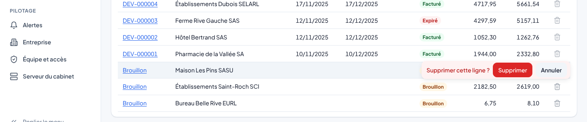
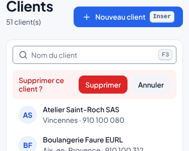
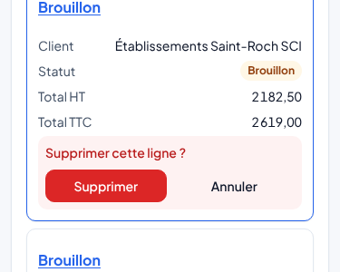

# Supprimer une ligne d'un tableau

Chaque tableau où une suppression a du sens porte une corbeille en bout de ligne. Un clic, une confirmation dans la
ligne même (Supprimer / Annuler, Échap annule), puis un message dans le toaster. Le composant est
`Components/Feedback/RowDelete.razor` dans `Lettra.UI.Shared` : il est donc le même dans le navigateur (PWA) et dans
l'application MAUI. Le clic sur la corbeille n'ouvre jamais la fiche de la ligne.

| Écran | Effet du clic | Quand la ligne ne se supprime pas |
|---|---|---|
| Devis (liste) | Supprime le brouillon après confirmation. | Devis envoyé, accepté, refusé ou expiré : le toaster explique de le marquer refusé ou de le laisser expirer. |
| Factures (liste) | Supprime le brouillon après confirmation. | Facture validée : le toaster explique d'émettre un avoir. Avoir validé : il reste au journal, on ne l'annule pas. |
| Lignes d'un devis ou d'une facture | Retire la ligne au premier clic, sans confirmation ; le brouillon s'enregistre tout seul (toaster « Modifications enregistrées »). | Pièce validée : pas de corbeille, les lignes sont en lecture seule. |
| Clients, fournisseurs | Retire la fiche des listes et des choix après confirmation. Ses devis et factures restent consultables. | Toujours possible. |
| Catalogue | Archive l'article (il ne se propose plus dans les pièces). Avec « Afficher les articles archivés », la même place offre **Réactiver**, sans confirmation. | Toujours possible. |

Pas de corbeille, volontairement : journaux, grand livre, balance et FEC (écritures comptables, obligation légale de
conservation), synchronisation et alertes (ce sont des constats, pas des données saisies). L'administration a déjà ses
propres boutons de suppression (équipes, rôles) ; une affectation se révoque.

## Comportement

- **Clavier** : dans les listes de clients, fournisseurs et articles, la touche Suppr sur la ligne active ouvre la même
  confirmation, Entrée la valide et Échap la ferme. Une option de liste ne contient rien de focalisable (WCAG, règle
  axe `nested-interactive`) : la corbeille et les boutons de confirmation y sont des cibles de souris, annoncées par
  `aria-keyshortcuts="Delete"` sur la ligne. Dans la grille des lignes d'une pièce, Ctrl+Suppr reste le raccourci ; la corbeille est hors de la
  tabulation pour ne pas allonger le parcours clavier.
- **Écrans** : sur ordinateur, la corbeille des listes de l'explorateur n'apparaît qu'au survol ou sur la ligne
  sélectionnée ; sur tablette et téléphone (pas de survol), elle est toujours visible. Sous 768 px les tableaux
  passent en cartes et la confirmation prend toute la largeur de la carte ; dans la grille des lignes, l'action passe
  sous la ligne quand la grille fait moins de 720 px.
- **Concurrence** : la suppression d'une fiche ouverte envoie sa version (`If-Match`, ADR-0013) ; une fiche modifiée
  entre-temps par quelqu'un d'autre est refusée avec un message, la ligne reste.
- **Messages** : tout passe par le toaster (succès, refus du serveur, explication d'une ligne bloquée).

## Clients et fournisseurs : suppression douce

Supprimer un client ou un fournisseur ne retire pas la ligne de la base : la fiche reçoit `IsArchived = true` et
disparaît des listes et des recherches (`ListAsync` filtre). Raisons :

- les devis, factures et avoirs numérotés, et le journal d'intégrité, citent le client ; la fiche doit rester lisible
  pour les relire ;
- la synchronisation (ADR-0007, ADR-0008) suppose qu'aucun élément n'est supprimé : le changement se propage comme une
  modification (`customer.delete` et `supplier.delete` dans la file d'envoi d'un appareil hors ligne, rejoués par le
  serveur, sans effet si la fiche est déjà supprimée).

API : `DELETE /api/v1/customers/{id}` et `DELETE /api/v1/suppliers/{id}` (permission `TiersModifier`, `If-Match`
obligatoire, `*` pour supprimer sans condition), réponse 204 ou 404. Migration `SuppressionDesTiers` (colonne
`IsArchived`, faux par défaut) dans les trois fournisseurs de base : les données existantes sont gardées.

Limite connue : aucun écran ne remet encore une fiche supprimée dans les listes ; les données sont gardées en base.

## Ajouter la corbeille à un autre tableau

1. Une colonne `lt-col-actions` (en-tête vide, libellé `Row.Actions` pour les lecteurs d'écran) ou, dans une liste de
   l'explorateur, un `` en fin de ligne.
2. `<RowDelete Label="…" OnDelete="…" />` ; `BlockedReason` quand la ligne ne se supprime pas (le clic l'affiche) ;
   `Confirm="false"` pour un retrait sans confirmation ; `Question`, `ActionText` et `IconName` pour une autre action
   (archiver, réactiver).
3. Les textes vont dans `Localization/Modules/Suppression.resx` et `.en.resx`.

## Captures

