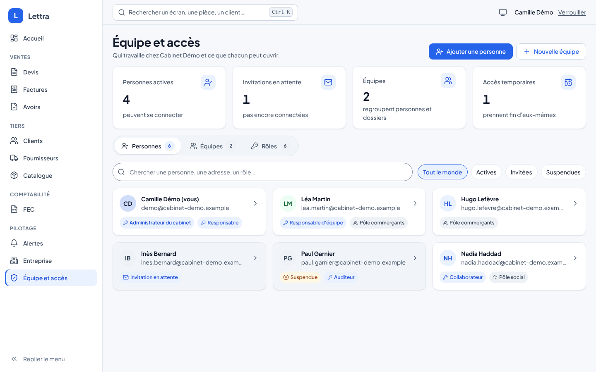
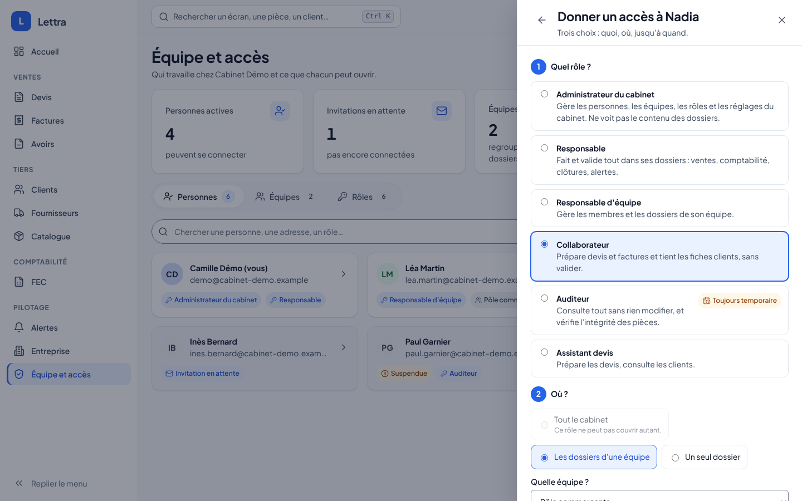
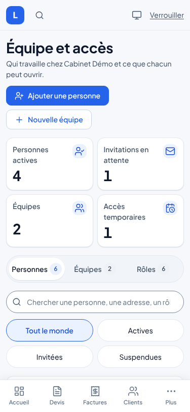
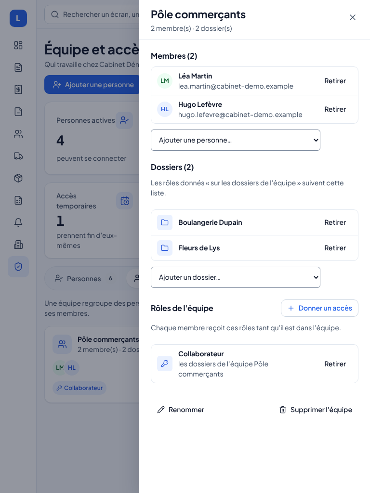

# Équipe et accès (`/admin`)

L'espace où un responsable du cabinet décide **qui travaille dans Lettra et ce que chacun peut ouvrir**, sans rien
connaître des permissions techniques. Il s'ouvre depuis le menu **Pilotage › Équipe et accès**, qui n'apparaît qu'aux
personnes qui administrent le cabinet ou une équipe.

## Pour l'administrateur

Trois onglets, en mots simples :

| Onglet | Ce qu'on y fait |
|---|---|
| **Personnes** | Voir chaque personne, son état (active, invitation en attente, suspendue) et ses rôles. Chercher, filtrer. Ouvrir une fiche qui dit **« Ce que Léa peut faire »** page par page, d'où vient chaque accès (directement ou par une équipe), et propose les gestes courants : donner un accès, retirer, ajouter à une équipe, modifier, suspendre, réactiver. |
| **Équipes** | Regrouper des personnes et des dossiers. Un rôle donné à l'équipe vaut pour tous ses membres, sur les dossiers de l'équipe. |
| **Rôles** | Les rôles fournis (Responsable, Collaborateur, Auditeur…) décrits par les pages qu'ils ouvrent, et les **rôles sur mesure** du cabinet, composés page par page d'un geste (Aucun, Voir, Modifier, Valider). Un tableau repliable montre tous les rôles côte à côte. |

Donner un accès se fait en **trois questions** (quel rôle, où, jusqu'à quand) et se résume en une phrase avant de
valider : « Nadia sera Auditeur sur tout le cabinet, jusqu'au 16/11/2026 inclus ». Un rôle qui doit s'arrêter (auditeur,
délégation) propose d'office une date ; un rôle qui ne peut pas couvrir tout le cabinet grise ce choix et dit pourquoi.

Chaque retrait se **défait** depuis le message qui le confirme (« Annuler »). Un administrateur ne peut ni se suspendre
ni se retirer son dernier accès d'administration : il faut un autre administrateur.

Sur téléphone, les cartes passent sur une colonne et chaque fiche s'ouvre en plein écran ; sur tablette, deux colonnes
et une fiche latérale. Les quatre thèmes (clair, sombre, ardoise, contraste élevé) s'appliquent.

| Téléphone | Tablette |
|---|---|
|  |  |

## Selon le mode de déploiement

| Mode | Ce qu'on voit |
|---|---|
| Navigateur, serveur du cabinet, SaaS | Tout l'espace, en écriture. Le registre est la base Catalog (personnes, équipes, rôles sur mesure). |
| Poste isolé (mode 1) | L'espace en **lecture seule** : le propriétaire du poste, ses deux rôles (Responsable, Administrateur du cabinet) et un message qui explique qu'un travail à plusieurs passe par le serveur du cabinet. |

## Qui voit quoi

| Droit de l'utilisateur | Ce que l'espace lui permet |
|---|---|
| Administrateur du cabinet | Tout : personnes, équipes, rôles sur mesure. |
| Responsable d'équipe | Ses équipes (membres, dossiers) ; il voit les personnes pour composer son équipe, et les rôles des seuls membres de ses équipes. |
| Autres | La page explique qu'elle est réservée aux responsables ; l'entrée de menu est cachée. |

Le serveur revérifie chaque geste : masquer un bouton n'est jamais la seule protection.

## Pour les développeurs

**Pages et permissions.** `AccessAreaPermissions` (Application/Authorization) relie les pages vues par l'administrateur
(`AccessAreaDto` : Devis, Factures, Avoirs, Tiers, Catalogue, Comptabilité, Alertes, Assistant, Postes, Administration,
Portail) aux permissions vérifiées par `AuthorizationBehavior`. Chaque niveau ajoute des permissions au précédent ;
`Describe` traduit un ensemble de permissions en pages, `Compose` traduit les pages d'un rôle sur mesure en permissions et
refuse l'administration et le portail (ils restent dans les rôles fournis). Devis, factures et avoirs se consultent
ensemble (même permission de lecture), ce que l'éditeur affiche.

**Routes** (groupe cabinet, `AdministrationEndpoints.MapCabinetAdministration` appelé par
`RightsEndpoints.MapCabinetRights`, plus `/api/v1/dossiers/acces` par `MapMyAccess`) :

| Méthode | Route | Cas d'usage |
|---|---|---|
| GET | `/api/v1/dossiers/acces?dossier=` | `GetMyAccessQuery` : cabinet, `CanAdminister`, niveaux par page |
| GET | `/api/v1/cabinets/{id}/administration` | `GetAdministrationOverviewQuery` : tout l'espace en une lecture |
| POST / PUT | `…/personnes`, `…/personnes/{userId}` | `InvitePersonCommand`, `UpdatePersonCommand` |
| POST | `…/personnes/{userId}/invitation` | `ResendInvitationCommand` : renvoi de l'e-mail d'invitation |
| PUT / DELETE | `…/groupes/{groupId}` | `RenameTeamCommand`, `DeleteTeamCommand` |
| POST / PUT / DELETE | `…/roles`, `…/roles/{key}` | `SaveCustomRoleCommand`, `DeleteCustomRoleCommand` |

Les autres gestes (comptes, attributions, membres, dossiers d'équipe) réutilisent les routes des droits existantes.

**Registre.** `IAuthorizationRegistry` (lecture d'ensemble et écritures propres à l'administration) a deux
implémentations : `CatalogAuthorizationRegistry` (EF, base Catalog) et `LocalAuthorizationRegistry` (mode 1, lecture
seule). La migration `EspaceAdministration` ajoute des colonnes nullables (nom et adresse des personnes, nom et
description des rôles sur mesure) : les données existantes sont conservées. La configuration
`Lettra:Authorization:Users:n` accepte `DisplayName` et `Email`, appliqués seulement s'ils sont renseignés.

**Interface.** `IAdministrationGateway` (HTTP et in-process), page `Administration.razor` et ses composants dans ce
dossier, styles `wwwroot/lettra-admin.css` (importé par `lettra.css`, jetons uniquement), textes
`Localization/Modules/Administration*.resx`. `NavItem.Page` cache une entrée de menu à qui n'ouvre pas la page.

**Tests.** `AdministrationApiTests` (de bout en bout sur le Catalog), `AccessAreaPermissionsTests`,
`AdministrationPageTests` (bUnit), `LocalCabinetAuthorizationTests` (mode 1). Captures :
`LETTRA_GALLERY_DIR=… dotnet test tests/Lettra.UI.Tests --filter AdministrationGalleryTests` puis
`node build/design-captures.cjs …` (375, 768 et 1440 px, aucun défilement horizontal).

## Limites connues

- Lettra envoie un e-mail d'invitation (français puis anglais) quand l'envoi d'e-mails est configuré (`Lettra:Email`,
  MailPit dans la démonstration) ; sinon, ou en cas d'échec, l'invitation reste valable et l'administrateur la renvoie
  ou prévient la personne.
- Une personne ajoutée ici n'a pas encore de compte Keycloak : dans la démonstration navigateur, elle apparaît et reçoit
  des accès, mais ne peut pas se connecter (création du compte côté Keycloak prévue en phase 7).
- Le message « Annuler » est propre à cet espace en attendant que le toaster partagé accepte une action.
